~# Database Schema — The Reading Compass

**Document version:** 1.1  
**Status:** Finalized for MVP architecture; implementation details remain subject to migration review  
**Last updated:** 2026-10-31

---

## 1. Purpose

This document defines the proposed PostgreSQL data model for **The Reading Compass**, an AI-powered reading companion that supports:

- User accounts and reading preferences
- A work-level book catalogue with optional edition records
- Personal libraries, TBR lists, reading progress, and ratings
- Search and personalized recommendations
- Reading journeys and their stages
- Feedback and interaction history
- Book embeddings for semantic retrieval

The schema is designed for an MVP that can evolve without prematurely introducing microservices or a separate vector database.

## 2. Finalized design decisions

The following decisions were confirmed during schema review.

| Decision | Selected approach | Schema implication |
|---|---|---|
| Rating scale | 1–5 stars | Store ratings as integer values from 1 to 5 |
| Reading progress | Pages and percentage | Store `current_page`, `total_pages`, and `progress_percent` in dedicated progress tracker |
| Embedding dimension | 384 | Use `VECTOR(384)` for book embeddings |
| Authentication | Email/password + Google OAuth | Support multiple authentication identities per user |
| Book identity | Work-level | Personal library entries reference a book work; edition is optional |
| Search | Hybrid | Combine PostgreSQL full-text search and trigram matching |

These are product-level decisions. Exact model revision, search-language configuration, and some operational policies are implementation details to validate.

## 3. Database technology

**Primary database:** PostgreSQL  
**Vector search:** pgvector  
**Fuzzy text matching:** pg_trgm

Required extensions:

```sql
CREATE EXTENSION IF NOT EXISTS vector;
CREATE EXTENSION IF NOT EXISTS pg_trgm;
```

PostgreSQL remains the source of truth for relational data. pgvector stores and searches semantic embeddings without requiring a separate vector database for the MVP.

## 4. Entity relationship overview

The principal relationships are:

- A `users` row owns one `user_profiles` row.
- A user can have multiple `user_auth_identities` (for example, Google OAuth and password-based login).
- A `book_work` can have multiple `book_editions`.
- A work can have multiple authors, genres, and subjects through join tables.
- A user can have many `user_books` entries, each tracking the user's shelf status for a work.
- A `user_books` row can have at most one `reading_progress` record tracking current progress.
- A user can record explicit `book_ratings` for works.
- A user can create multiple `reading_lists`, each containing ordered `reading_list_books`.
- A user performs append-only `user_interactions` informing recommendations.
- A user can generate many `recommendation_requests`; each request can return multiple `recommendation_items`.
- A user can create multiple `reading_journeys`; each journey contains ordered stages and selected books.
- A user can set optional `reading_goals` that may guide journeys or recommendation requests.
- A work can have one or more versioned embeddings.

```mermaid
erDiagram
    USERS ||--|| USER_PROFILES : has
    USERS ||--o{ USER_AUTH_IDENTITIES : authenticates_with
    USERS ||--o{ USER_PREFERENCES : sets
    BOOK_WORKS ||--o{ BOOK_EDITIONS : has
    BOOK_WORKS ||--o{ BOOK_WORK_AUTHORS : credited
    AUTHORS ||--o{ BOOK_WORK_AUTHORS : writes
    BOOK_WORKS ||--o{ BOOK_WORK_GENRES : classified_as
    GENRES ||--o{ BOOK_WORK_GENRES : includes
    BOOK_WORKS ||--o{ BOOK_WORK_SUBJECTS : covers
    SUBJECTS ||--o{ BOOK_WORK_SUBJECTS : includes
    USERS ||--o{ USER_BOOKS : tracks
    BOOK_WORKS ||--o{ USER_BOOKS : appears_in
    BOOK_EDITIONS ||--o{ USER_BOOKS : format_context
    USER_BOOKS ||--o| READING_PROGRESS : has
    USERS ||--o{ BOOK_RATINGS : rates
    BOOK_WORKS ||--o{ BOOK_RATINGS : rated_in
    USERS ||--o{ READING_LISTS : creates
    READING_LISTS ||--o{ READING_LIST_BOOKS : contains
    BOOK_WORKS ||--o{ READING_LIST_BOOKS : listed_in
    USERS ||--o{ USER_INTERACTIONS : performs
    BOOK_WORKS ||--o{ USER_INTERACTIONS : receives
    USERS ||--o| USER_INTEREST_PROFILES : maintains
    USERS ||--o{ READING_GOALS : defines
    READING_GOALS o|--o{ READING_JOURNEYS : informs
    USERS ||--o{ RECOMMENDATION_REQUESTS : requests
    RECOMMENDATION_REQUESTS ||--o{ RECOMMENDATION_ITEMS : returns
    BOOK_WORKS ||--o{ RECOMMENDATION_ITEMS : recommended
    USERS ||--o{ READING_JOURNEYS : creates
    READING_JOURNEYS ||--o{ JOURNEY_STAGES : contains
    JOURNEY_STAGES ||--o{ JOURNEY_STAGE_BOOKS : suggests
    BOOK_WORKS ||--o{ JOURNEY_STAGE_BOOKS : selected
    BOOK_WORKS ||--o{ BOOK_EMBEDDINGS : represented_by
```



The diagram is conceptual. The SQL-level constraints and indexes should be implemented through versioned migrations.

## 5. Core account and preference tables

### 5.1 `users`

Stores the application account.

| Column | Type | Rules / purpose |
|---|---|---|
| `id` | UUID | Primary key |
| `email` | CITEXT or VARCHAR | Unique, normalized email |
| `display_name` | VARCHAR(120) | User-facing name |
| `password_hash` | TEXT, nullable | Present for password login; null for OAuth-only accounts |
| `email_verified_at` | TIMESTAMPTZ, nullable | Verification timestamp |
| `status` | VARCHAR(20) | For example: `active`, `pending`, `disabled` |
| `created_at` | TIMESTAMPTZ | Creation time |
| `updated_at` | TIMESTAMPTZ | Last update |

Use a case-insensitive unique email strategy. If `CITEXT` is selected, enable the extension; otherwise normalize email consistently in the application and enforce uniqueness on the normalized value.

### 5.2 `user_auth_identities`

Stores external authentication identities, including Google OAuth.

| Column | Type | Rules / purpose |
|---|---|---|
| `id` | UUID | Primary key |
| `user_id` | UUID | FK → `users.id` |
| `provider` | VARCHAR(30) | For example: `google`, `password` |
| `provider_subject` | VARCHAR(255) | Stable provider-side user identifier |
| `provider_email` | VARCHAR(320), nullable | Email reported by provider |
| `created_at` | TIMESTAMPTZ | Link creation time |

Constraints:

- Unique (`provider`, `provider_subject`).
- A user may link multiple providers.
- Never use a mutable display name as the OAuth identity key.
- Account linking must verify ownership of both identities; do not automatically merge accounts solely because email strings match.

For a password-based account, the password hash can remain on `users` or be represented as a `password` identity. Keep one approach consistent in implementation. The proposed MVP uses `users.password_hash` for password login and `user_auth_identities` for external providers.

### 5.3 `user_profiles`

Stores relatively stable reader-profile information.

| Column | Type | Rules / purpose |
|---|---|---|
| `user_id` | UUID | Primary key and FK → `users.id` |
| `reader_level` | VARCHAR(30) | Beginner, casual, avid, or knowledge-oriented |
| `preferred_language` | VARCHAR(12) | Preferred content language |
| `bio` | TEXT, nullable | Optional user-provided context |
| `created_at` | TIMESTAMPTZ | Creation time |
| `updated_at` | TIMESTAMPTZ | Last update |

Avoid storing sensitive inferences about users. Reader-level and interest information should be user-provided or transparently editable.

### 5.4 `user_preferences`

Stores explicit, editable preferences. A row can represent a preference category/value pair.

| Column | Type | Rules / purpose |
|---|---|---|
| `id` | UUID | Primary key |
| `user_id` | UUID | FK → `users.id` |
| `preference_type` | VARCHAR(40) | For example: `genre`, `subject`, `author`, `language`, `length`, `difficulty`, `goal` |
| `preference_value` | TEXT | Selected value |
| `preference_weight` | NUMERIC(4,3) | Optional strength, constrained to 0–1 |
| `source` | VARCHAR(20) | `onboarding` or `user_edit` |
| `created_at` | TIMESTAMPTZ | Creation time |
| `updated_at` | TIMESTAMPTZ | Last update |

Use a unique constraint appropriate to the chosen preference model, such as (`user_id`, `preference_type`, `preference_value`). Keep explicit preferences distinct from inferred preferences so the user can inspect and override them. Because `preference_value` stores a text label/slug/UUID rather than a foreign key, retrieval resolves genre, subject, and author preferences against controlled catalogue tables (`genres`, `subjects`, `authors`)—with author matching performing UUID lookup against `authors.id` or exact match against `authors.normalized_name` (no fuzzy matching). Negative preference support (`excluded_author`, `excluded_subject`) is deferred beyond Milestone 5.2 (no prefix conventions or schema changes added yet).

## 6. Book catalogue

### 6.1 `book_works`

Represents a book work rather than a particular physical or digital edition. This is the canonical book identity used for recommendations and personal-library tracking.

| Column | Type | Rules / purpose |
|---|---|---|
| `id` | UUID | Primary key |
| `canonical_title` | VARCHAR(500) | Required normalized title |
| `subtitle` | VARCHAR(500), nullable | Subtitle |
| `description` | TEXT, nullable | Curated or provider description |
| `original_language` | VARCHAR(12), nullable | Original language where known |
| `first_published_year` | SMALLINT, nullable | Approximate first publication year |
| `difficulty_level` | VARCHAR(30), nullable | Optional curated reading difficulty |
| `estimated_reading_minutes` | INTEGER, nullable | Optional estimate |
| `cover_image_url` | TEXT, nullable | Preferred cover image |
| `metadata_status` | VARCHAR(20) | For example: `verified`, `unverified`, `needs_review` |
| `created_at` | TIMESTAMPTZ | Creation time |
| `updated_at` | TIMESTAMPTZ | Last update |

Do not assume that provider records with similar titles always refer to the same work. Catalogue ingestion needs a deduplication and review strategy.

### 6.2 `book_editions`

Stores edition-specific metadata while preserving the work-level identity.

| Column | Type | Rules / purpose |
|---|---|---|
| `id` | UUID | Primary key |
| `work_id` | UUID | FK → `book_works.id` |
| `isbn_10` | VARCHAR(10), nullable | Edition ISBN-10 |
| `isbn_13` | VARCHAR(13), nullable | Edition ISBN-13 |
| `publisher` | VARCHAR(255), nullable | Publisher |
| `publication_date` | DATE, nullable | Edition publication date |
| `page_count` | INTEGER, nullable | Edition page count |
| `format` | VARCHAR(30), nullable | Paperback, hardcover, ebook, audiobook, etc. |
| `language` | VARCHAR(12), nullable | Edition language |
| `cover_image_url` | TEXT, nullable | Edition cover |
| `created_at` | TIMESTAMPTZ | Creation time |

Add partial unique indexes for non-null ISBN values. Page count belongs to an edition because different editions can have different pagination.

### 6.3 `authors`

| Column | Type | Rules / purpose |
|---|---|---|
| `id` | UUID | Primary key |
| `name` | VARCHAR(255) | Author display name |
| `normalized_name` | VARCHAR(255) | Deduplication/search value |
| `bio` | TEXT, nullable | Optional biography |
| `created_at` | TIMESTAMPTZ | Creation time |

### 6.4 `book_work_authors`

Join table for the many-to-many relationship between works and authors.

| Column | Type | Rules / purpose |
|---|---|---|
| `work_id` | UUID | FK → `book_works.id` |
| `author_id` | UUID | FK → `authors.id` |
| `author_role` | VARCHAR(30) | Author, editor, translator, etc. |
| `display_order` | SMALLINT | Order shown in catalogue |

Primary key: (`work_id`, `author_id`, `author_role`).

### 6.5 `genres` and `book_work_genres`

`genres` stores controlled genre labels. `book_work_genres` links works to genres.

Suggested `genres` columns:

- `id` UUID primary key
- `name` VARCHAR(100) unique
- `slug` VARCHAR(120) unique

Suggested `book_work_genres` columns:

- `work_id` UUID FK
- `genre_id` UUID FK
- `source` VARCHAR(20), such as `provider`, `curated`, or `user`
- Composite primary key (`work_id`, `genre_id`)

### 6.6 `subjects` and `book_work_subjects`

Subjects represent topics and knowledge areas, such as economics, psychology, leadership, or quantum computing. They are more granular than broad genres and support goal-oriented reading journeys.

Suggested `subjects` columns:

- `id` UUID primary key
- `name` VARCHAR(150) unique
- `slug` VARCHAR(170) unique
- `description` TEXT, nullable
- `parent_subject_id` UUID nullable FK → `subjects.id`

Suggested `book_work_subjects` columns:

- `work_id` UUID FK
- `subject_id` UUID FK
- `relevance_weight` NUMERIC(4,3), optional 0–1
- `source` VARCHAR(20)
- Composite primary key (`work_id`, `subject_id`)

### 6.7 `subject_prerequisites`

Represents optional prerequisite relationships between subjects.

| Column | Type | Rules / purpose |
|---|---|---|
| `subject_id` | UUID | FK → `subjects.id` |
| `prerequisite_subject_id` | UUID | FK → `subjects.id` |
| `strength` | NUMERIC(4,3) | Optional confidence/importance from 0–1 |
| `notes` | TEXT, nullable | Explanation |

Primary key: (`subject_id`, `prerequisite_subject_id`). Add a check preventing a subject from being its own prerequisite. Validate the graph for cycles in application logic or a data-quality job.

## 7. External catalogue identifiers and provenance

### 7.1 `book_external_ids`

Maps provider records to canonical works.

| Column | Type | Rules / purpose |
|---|---|---|
| `id` | UUID | Primary key |
| `work_id` | UUID | FK → `book_works.id` |
| `provider` | VARCHAR(40) | For example: `google_books`, `open_library` |
| `provider_item_id` | VARCHAR(255) | Provider's stable identifier |
| `provider_url` | TEXT, nullable | Source record URL |
| `last_synced_at` | TIMESTAMPTZ, nullable | Last successful sync |
| `created_at` | TIMESTAMPTZ | Creation time |

Unique (`provider`, `provider_item_id`).

### 7.2 `book_metadata_sources`

Optional provenance table for fields or catalogue snapshots that need traceability.

Suggested columns:

- `id` UUID primary key
- `work_id` UUID FK
- `provider` VARCHAR(40)
- `field_name` VARCHAR(100)
- `source_value` JSONB
- `retrieved_at` TIMESTAMPTZ
- `is_verified` BOOLEAN default false

For the MVP, a simpler provider-sync log may be enough. Avoid building a complex field-level provenance system until metadata conflicts become a real operational problem.

## 8. Personal library and reading activity

### 8.1 `user_books`

Represents a user's canonical library record and bookshelf membership for a canonical book work.

| Column | Type | Rules / purpose |
|---|---|---|
| `id` | UUID | Primary key |
| `user_id` | UUID | FK → `users.id` (ON DELETE CASCADE) |
| `work_id` | UUID | FK → `book_works.id` (ON DELETE CASCADE) |
| `edition_id` | UUID, nullable | Optional FK → `book_editions.id` (ON DELETE SET NULL) |
| `status` | VARCHAR(20) | `want_to_read`, `currently_reading`, `completed`, `paused`, `abandoned` |
| `notes` | TEXT, nullable | Private user notes for this library item |
| `created_at` | TIMESTAMPTZ | Creation time |
| `updated_at` | TIMESTAMPTZ | Last update |

Constraints and behavior:

- Unique (`user_id`, `work_id`) for one personal library entry per work.
- Status check constraint: `status IN ('want_to_read', 'currently_reading', 'completed', 'paused', 'abandoned')`.
- Index `(user_id, status)` for fast filtering of library shelves.
- Index `(work_id)` for reverse lookup.
- Index `(edition_id)` for foreign key joins.
- Edition-work consistency: `edition_id` must belong to `work_id`. Enforced through service validation; can be reinforced with a composite foreign key if a unique constraint `(id, work_id)` is added to `book_editions` in a future catalogue migration.
- Deleting a `user_books` record cascades to its `reading_progress`, but preserves `book_ratings` and `reading_list_books`.

### 8.2 `reading_progress`

Tracks the optional current reading progress state for an entry in `user_books`.

| Column | Type | Rules / purpose |
|---|---|---|
| `id` | UUID | Primary key |
| `user_book_id` | UUID | Unique FK → `user_books.id` (ON DELETE CASCADE) |
| `current_page` | INTEGER, nullable | Current page reached (`CHECK >= 0`) |
| `total_pages` | INTEGER, nullable | Total page count (`CHECK > 0`) |
| `progress_percent` | NUMERIC(5,2) | Progress percentage 0–100 (`CHECK 0.00 <= p <= 100.00`) |
| `started_at` | DATE, nullable | Reading start date |
| `completed_at` | DATE, nullable | Completion date |
| `last_read_at` | TIMESTAMPTZ, nullable | Timestamp of latest progress update |
| `created_at` | TIMESTAMPTZ | Creation time |
| `updated_at` | TIMESTAMPTZ | Last update |

Constraints and behavior:

- At most one `reading_progress` row per `user_books` entry guaranteed by unique constraint (`UNIQUE (user_book_id)`). Progress tracking is initialized upon reading initiation; entries in `user_books` without progress records are permitted. Redundant secondary index on `user_book_id` is omitted.
- Page check constraints:
  - `CHECK (current_page IS NULL OR current_page >= 0)`
  - `CHECK (total_pages IS NULL OR total_pages > 0)`
  - `CHECK (current_page IS NULL OR total_pages IS NULL OR current_page <= total_pages)`
- Shelf status synchronization (transactional service-layer rules):
  - Starting: transitioning a book to active reading sets `user_books.status = 'currently_reading'` and initializes `reading_progress.started_at` to the current date if not already set.
  - Completing: marking a book as finished sets `user_books.status = 'completed'`, `reading_progress.progress_percent = 100.00`, `reading_progress.completed_at = current_date`, and if `total_pages` is known, sets `reading_progress.current_page = reading_progress.total_pages`.
  - Both updates are executed within a single database transaction.
- Progress consistency rules:
  - When both `current_page` and `total_pages` are provided, the backend calculates/validates `progress_percent = round((current_page::numeric / total_pages::numeric) * 100.0, 2)`.
  - When page numbers are unavailable (e.g. audiobooks, web articles), percentage-only progress is permitted.
  - Page bounds (`current_page <= total_pages`) and percentage bounds (`0.00 <= progress_percent <= 100.00`) are strictly enforced.

### 8.3 `book_ratings`

Stores explicit ratings and optional reviews, decoupled from library membership.

| Column | Type | Rules / purpose |
|---|---|---|
| `id` | UUID | Primary key |
| `user_id` | UUID | FK → `users.id` (ON DELETE CASCADE) |
| `work_id` | UUID | FK → `book_works.id` (ON DELETE CASCADE) |
| `rating` | SMALLINT | Integer rating 1–5 (`CHECK (rating >= 1 AND rating <= 5)`) |
| `review_text` | TEXT, nullable | Optional user review |
| `is_spoiler` | BOOLEAN | Default false |
| `created_at` | TIMESTAMPTZ | Rating timestamp |
| `updated_at` | TIMESTAMPTZ | Review update timestamp |

Constraints and behavior:

- Unique (`user_id`, `work_id`): exactly one rating per user per book work.
- Rating check constraint: `rating >= 1 AND rating <= 5` (integer stars).
- Index `(work_id, rating)` for computing average book ratings and distribution metrics.
- Index `(user_id, rating)` for recommendation preference profiling.
- Transactional telemetry: Rating creation, modification, or removal must emit a corresponding `UserInteraction(type='rate')` event within the exact same database transaction.
- Independence: A user can rate a work without having it in their active library shelves; deleting a `user_books` shelf entry does not delete the user's rating.

### 8.4 `reading_lists`

Allows users to create custom and curated book collections (e.g. "Favorites", "2026 TBR", "Deep Work").

| Column | Type | Rules / purpose |
|---|---|---|
| `id` | UUID | Primary key |
| `user_id` | UUID | FK → `users.id` (ON DELETE CASCADE) |
| `name` | VARCHAR(120) | User-facing list name |
| `description` | TEXT, nullable | Optional list summary |
| `is_public` | BOOLEAN | Default false (private by default) |
| `created_at` | TIMESTAMPTZ | Creation time |
| `updated_at` | TIMESTAMPTZ | Last update |

Constraints and behavior:

- Case-insensitive unique list name per user via unique functional index: `CREATE UNIQUE INDEX uq_reading_lists_user_lower_name ON reading_lists (user_id, lower(name))`.
- Index `(user_id, created_at DESC)` for retrieving a user's lists.

### 8.5 `reading_list_books`

Ordered join table linking reading lists directly to canonical `book_works`.

| Column | Type | Rules / purpose |
|---|---|---|
| `list_id` | UUID | FK → `reading_lists.id` (ON DELETE CASCADE), PK 1 |
| `work_id` | UUID | FK → `book_works.id` (ON DELETE CASCADE), PK 2 |
| `position` | INTEGER | 1-based order within list (`CHECK (position >= 1)`) |
| `notes` | TEXT, nullable | Optional note specific to list inclusion |
| `added_at` | TIMESTAMPTZ | Addition timestamp |

Constraints and behavior:

- Composite primary key: (`list_id`, `work_id`). Guarantees a book cannot appear twice in the same list.
- Order constraint: `UNIQUE (list_id, position)` ensures unambiguous ordering without duplicate positions. Redundant secondary index on `(list_id, position)` is omitted.
- Index `(work_id)` for finding all lists that include a given work.
- Transactional reordering: Reordering list items must occur within a single database transaction using temporary positions above the current maximum (or temporary offsets) to avoid intermediate `UNIQUE (list_id, position)` constraint collisions while preserving continuous 1-based ordering.
- Reference target: References `book_works` directly rather than `user_books`, allowing users to curate lists of books without forcibly placing them onto their personal active bookshelf.

### 8.6 `user_interactions`

Append-only event log recording user actions for recommendation scoring and behavioral analytics.

| Column | Type | Rules / purpose |
|---|---|---|
| `id` | UUID | Primary key |
| `user_id` | UUID | FK → `users.id` (ON DELETE CASCADE) |
| `work_id` | UUID, nullable | FK → `book_works.id` (ON DELETE CASCADE) |
| `interaction_type` | VARCHAR(40) | Supported interaction event type |
| `rating_value` | SMALLINT, nullable | 1–5 integer rating when event is a rating |
| `context` | JSONB, nullable | Optional client context (recommendation_request_id, search_query, etc.) |
| `created_at` | TIMESTAMPTZ | Event time |

Constraints and behavior:

- Check constraint on supported types:
  ```sql
  CHECK (interaction_type IN (
      'view',
      'click',
      'save',
      'dismiss',
      'rate',
      'start',
      'progress',
      'complete',
      'abandon',
      'recommendation_click',
      'recommendation_helpful',
      'recommendation_not_helpful'
  ))
  ```
- Check constraint on rating: `CHECK (rating_value IS NULL OR (rating_value >= 1 AND rating_value <= 5))`.
- Append-only event history: Never update or delete interaction logs during normal application operations. Account deletion and catalogue work deletion cascade-delete related interaction events. Rating deletion generates a `rate` event with `rating_value = NULL` and a deletion indicator in `context` (e.g. `{"action": "delete"}`). Current operational state lives in `reading_progress`, `book_ratings`, `user_books`, and `recommendation_items`.
- Recommendation feedback tracking: Recommendation item feedback (`helpful`, `not_helpful`, `save`, `dismiss`) stores its latest status directly on `recommendation_items` and simultaneously logs an append-only event (`recommendation_helpful`, `recommendation_not_helpful`, `save`, `dismiss`) in `user_interactions` to preserve full event history for profile evolution and evaluation metrics.
- Index `(user_id, created_at DESC)` for user event streams.
- Index `(user_id, interaction_type, created_at DESC)` for filtered activity feeds.
- Index `(work_id, interaction_type)` for calculating book popularity and interaction metrics.

### 8.7 `reading_goals` (Milestone 4A)

Stores explicit user reading and learning goals.

| Column | Type | Rules / purpose |
|---|---|---|
| `id` | UUID | Primary key |
| `user_id` | UUID | FK → `users.id` (ON DELETE CASCADE) |
| `title` | VARCHAR(160) | Goal title |
| `description` | TEXT, nullable | Goal objective |
| `goal_type` | VARCHAR(40) | Supported goal categories (`learn_subject`, `read_more`, `explore_genre`, `career_development`, `skill_depth`, `custom`) |
| `target_date` | DATE, nullable | Target completion date |
| `status` | VARCHAR(20) | Goal status (`active`, `completed`, `paused`, `abandoned`), default `'active'` |
| `created_at` | TIMESTAMPTZ | Creation time |
| `updated_at` | TIMESTAMPTZ | Last update |

Constraints and behavior:

- Goal type constraint: `CHECK (goal_type IN ('learn_subject', 'read_more', 'explore_genre', 'career_development', 'skill_depth', 'custom'))`. Reconciled with PRD requirements across structured learning, reading habits, breadth exploration, professional development, and personal objectives.
- Status constraint: `CHECK (status IN ('active', 'completed', 'paused', 'abandoned'))`.
- Cross-user boundary protection: `UNIQUE (id, user_id)` (`uq_reading_goals_id_user`). This composite unique constraint enables future reading journeys to enforce `FOREIGN KEY (goal_id, user_id) REFERENCES reading_goals (id, user_id)` at the database level, guaranteeing that journey goal assignments cannot cross user boundaries.
- Index `(user_id, status)` for fast user goal filtering.

### 8.8 Deferred reading features

The following features are explicitly deferred beyond the initial MVP:

- `ReadingSession` history: Session-level interval logs (e.g., date, reading duration in minutes, pages read per individual session, reading speed velocity). Current progress remains a single 1-to-1 state in `reading_progress`.
- Social reading lists: Collaborative multi-user editing, public list followers, and list comments.
- Social reviews: Comments, upvotes, review threads, and public spoiler moderation.

## 9. Recommendation records (Milestone 4A)

### 9.1 `recommendation_requests`

Stores the context, filters, and configuration for a recommendation run.

| Column | Type | Rules / purpose |
|---|---|---|
| `id` | UUID | Primary key |
| `user_id` | UUID | FK → `users.id` (ON DELETE CASCADE) |
| `request_type` | VARCHAR(40) | Recommendation intent category |
| `request_context` | JSONB, nullable | User prompt, mood, goal_id, and filter constraints |
| `algorithm_version` | VARCHAR(40) | Version of ranking configuration (e.g. `'hybrid-v1.0'`) |
| `created_at` | TIMESTAMPTZ | Request time |

Constraints and behavior:

- Request type check: `CHECK (request_type IN ('next_read', 'discover', 'tbr_priority', 'goal_based', 'mood_based', 'new_author'))`.
- Foreign key: `user_id` cascades on user account deletion (`ON DELETE CASCADE`).
- Index `(user_id, created_at DESC)` for retrieving past recommendation runs.
- Auditability: Preserves the exact algorithm version and query context for reproducible evaluation and regression testing.

### 9.2 `recommendation_items`

Stores the ordered, diversified recommendations returned for a request, including scores, component breakdowns, explanation reason codes, and user feedback.

| Column | Type | Rules / purpose |
|---|---|---|
| `id` | UUID | Primary key |
| `request_id` | UUID | FK → `recommendation_requests.id` (ON DELETE CASCADE) |
| `work_id` | UUID | FK → `book_works.id` (ON DELETE CASCADE) |
| `rank_position` | INTEGER | 1-based display rank (`CHECK (rank_position >= 1)`) |
| `score` | NUMERIC(8,6) | Final normalized ranking score (`CHECK (score >= 0.000000 AND score <= 1.000000)`) |
| `score_breakdown` | JSONB, nullable | Component scores used in the scoring formula |
| `reason_codes` | JSONB, nullable | Structured explanation reasons from controlled registry |
| `feedback_type` | VARCHAR(30), nullable | Latest user feedback (`helpful`, `not_helpful`, `save`, `dismiss`) |
| `feedback_reason` | TEXT, nullable | Optional user-supplied explanation for feedback |
| `feedback_at` | TIMESTAMPTZ, nullable | Timestamp feedback was submitted |
| `created_at` | TIMESTAMPTZ | Creation time |

Constraints and behavior:

- Uniqueness:
  - `UNIQUE (request_id, work_id)` prevents the same work appearing twice in a recommendation run.
  - `UNIQUE (request_id, rank_position)` ensures unambiguous ordering.
- Score normalization: `score` is a deterministic normalized ranking value strictly in the range `0 <= score <= 1` (stored as `NUMERIC(8,6)`). It represents relative rank ordering within candidate pools, not a probability or an objective book-quality measurement.
- Score breakdown schema: Structured JSON mapping component features:
  ```json
  {
    "semantic": 0.91,
    "goal": 0.88,
    "topic": 0.84,
    "author": 0.70,
    "difficulty": 0.95,
    "novelty": 0.82
  }
  ```
- Reason codes schema & registry: JSON array of strings drawn strictly from the controlled reason registry:
  - `MATCHES_CURRENT_GOAL`: Direct match with user's active reading goal.
  - `MATCHES_FAVORITE_SUBJECT`: Aligns with explicit reader subject preferences.
  - `SIMILAR_TO_HIGHLY_RATED_BOOK`: High semantic similarity to a book rated 4 or 5 by the user.
  - `BEGINNER_FRIENDLY`: Fits reader's introductory proficiency level.
  - `INTRODUCES_NEW_AUTHOR`: Controlled discovery signal for unread author.
  - `COMPLEMENTS_TBR`: High thematic synergy with books on user's TBR list.
  - `TOPIC_RELEVANCE`: Strong keyword/subject match with prompt.
  - `HIGH_BOOK_RATING`: Positive general reader response.
  - `POPULAR_IN_GENRE`: Well-received exemplar within candidate genre.
  - `NEXT_STEP_IN_SUBJECT_JOURNEY`: Logical subsequent milestone in a structured reading sequence (supported future reason code; deferred to Milestone 4B with Learning Journeys).
  *LLM Grounding:* Natural language explanations generated by the assistant must be grounded in these stored reason codes and verified catalogue metadata; the LLM must never invent unsupported claims.
- Feedback check: `CHECK (feedback_type IS NULL OR feedback_type IN ('helpful', 'not_helpful', 'save', 'dismiss'))`.
- Index `(work_id)` for reverse lookups and tracking recommendation frequency.

## 10. Reading journeys (Deferred to Milestone 4B)

> [!NOTE]
> Reading journeys are architecturally specified below and will be implemented in **Milestone 4B — Learning Journey Foundation**. They are not included in the Milestone 4A implementation scope.

### 10.1 `reading_journeys`

Represents structured learning curricula and milestone roadmaps.

| Column | Type | Rules / purpose |
|---|---|---|
| `id` | UUID | Primary key |
| `user_id` | UUID | FK → `users.id` (ON DELETE CASCADE) |
| `goal_id` | UUID, nullable | Part of composite FK `(goal_id, user_id) → reading_goals(id, user_id)` (ON DELETE SET NULL (goal_id)) |
| `title` | VARCHAR(200) | Journey title |
| `description` | TEXT, nullable | Journey summary |
| `status` | VARCHAR(20) | `draft`, `active`, `completed`, `archived` |
| `created_at` | TIMESTAMPTZ | Creation time |
| `updated_at` | TIMESTAMPTZ | Last update |

Constraints and behavior:
- Status check: `CHECK (status IN ('draft', 'active', 'completed', 'archived'))`, default `'draft'`.
- Composite FK for user ownership & deletion behavior:
  `FOREIGN KEY (goal_id, user_id) REFERENCES reading_goals (id, user_id) ON DELETE SET NULL (goal_id)`
  ensures a journey can only be attached to a goal owned by the same user. Using column-specific `ON DELETE SET NULL (goal_id)` (supported in PostgreSQL 15+) ensures that deleting a reading goal only nulls `goal_id` and does not attempt to null the non-nullable `user_id`. For database environments or tooling where column-specific `ON DELETE SET NULL` is not available, the safe alternative is service-layer disassociation (setting `goal_id = NULL` prior to goal deletion) or an explicit `BEFORE DELETE` trigger on `reading_goals`.
- Index `(user_id, status)` for user journey dashboards.

### 10.2 `journey_stages`

Represents progressive, ordered milestones within a journey.

| Column | Type | Rules / purpose |
|---|---|---|
| `id` | UUID | Primary key |
| `journey_id` | UUID | FK → `reading_journeys.id` (ON DELETE CASCADE) |
| `subject_id` | UUID, nullable | FK → `subjects.id` (ON DELETE SET NULL) |
| `title` | VARCHAR(200) | Stage title (e.g. "Foundational Concepts") |
| `description` | TEXT, nullable | Stage objective |
| `stage_order` | INTEGER | Position in journey (`CHECK (stage_order >= 1)`) |
| `status` | VARCHAR(20) | `locked`, `available`, `in_progress`, `completed` |
| `created_at` | TIMESTAMPTZ | Creation time |
| `updated_at` | TIMESTAMPTZ | Last update |

Constraints and behavior:
- Unambiguous sequence: `UNIQUE (journey_id, stage_order)` (`uq_journey_stages_journey_order`).
- Status check: `CHECK (status IN ('locked', 'available', 'in_progress', 'completed'))`, default `'locked'`.

### 10.3 `journey_stage_books`

Links suggested canonical works to a journey stage.

| Column | Type | Rules / purpose |
|---|---|---|
| `id` | UUID | Primary key |
| `stage_id` | UUID | FK → `journey_stages.id` (ON DELETE CASCADE) |
| `work_id` | UUID | FK → `book_works.id` (ON DELETE CASCADE) |
| `selection_order` | INTEGER | Display order within stage (`CHECK (selection_order >= 1)`) |
| `is_required` | BOOLEAN | Whether book is core or supplementary (default `false`) |
| `selection_reason` | TEXT, nullable | Grounded reason for stage assignment |
| `created_at` | TIMESTAMPTZ | Creation time |

Constraints:
- Work uniqueness: `UNIQUE (stage_id, work_id)` (`uq_journey_stage_books_stage_work`).
- Order uniqueness: `UNIQUE (stage_id, selection_order)` (`uq_journey_stage_books_stage_order`).
- Position check: `CHECK (selection_order >= 1)` (`ck_journey_stage_books_selection_order`).

## 11. Vectors and dynamic reader profiles (Milestone 4A)

### 11.1 `book_embeddings`

Stores semantic dense vector representations at the canonical work level.

| Column | Type | Rules / purpose |
|---|---|---|
| `id` | UUID | Primary key |
| `work_id` | UUID | FK → `book_works.id` (ON DELETE CASCADE) |
| `model_name` | VARCHAR(160) | Model identifier (e.g. `'all-MiniLM-L6-v2'`) |
| `model_revision` | VARCHAR(160) | Pinned Git commit hash / model revision |
| `embedding` | VECTOR(384) | 384-dimensional dense vector |
| `source_text_hash` | VARCHAR(128) | SHA-256 hash of constructed input text |
| `is_active` | BOOLEAN | Whether this is the active embedding version (`default=true`) |
| `created_at` | TIMESTAMPTZ | Generation time |

Constraints and behavior:

- Idempotency & uniqueness: `UNIQUE (work_id, model_name, model_revision, source_text_hash)` (`uq_book_embeddings_work_model_hash`) prevents duplicate generation of identical representations.
- Active version partial unique index:
  ```sql
  CREATE UNIQUE INDEX uq_book_embeddings_active_work
  ON book_embeddings (work_id, model_name, model_revision)
  WHERE is_active = true;
  ```
  Guarantees that at most one active embedding exists per canonical work for a given model revision (a work may have zero active embeddings if embedding generation is pending or deactivated).
- Version lifecycle: When generating a replacement embedding (e.g. following catalogue metadata enrichment), deactivate the previous version (`is_active = false`) within the same transaction. Recommendation retrieval must strictly filter to active embeddings (`WHERE is_active = true`).
- HNSW index:
  ```sql
  CREATE INDEX ix_book_embeddings_hnsw
  ON book_embeddings
  USING hnsw (embedding vector_cosine_ops);
  ```
  *(Retrieval note: Because this index covers all rows regardless of `is_active`, `model_name`, and `model_revision`, semantic candidate queries filter post-scan and rely on bounded oversampling/expansion or iterative scanning; if multi-revision embedding history grows large, evaluate a partial HNSW index `WHERE is_active = true`).*
- Work-level representation: Embeddings are generated per canonical work, not per physical edition.
- Deployment prerequisites: Requires the `vector` extension in PostgreSQL (`CREATE EXTENSION IF NOT EXISTS vector;`). In production or managed cloud databases (RDS, Cloud SQL), the database user or migration role must have extension creation privileges, or the extension must be pre-enabled by an administrator.

### 11.2 `user_interest_profiles`

Caches the normalized reader interest vector ($p_u$) and inferred topic affinity weights to enable fast vector retrieval without recomputing historical events on every recommendation request.

| Column | Type | Rules / purpose |
|---|---|---|
| `id` | UUID | Primary key |
| `user_id` | UUID | FK → `users.id` (ON DELETE CASCADE), UNIQUE |
| `model_name` | VARCHAR(160) | Embedding model matching `book_embeddings` |
| `model_revision` | VARCHAR(160) | Pinned model revision matching `book_embeddings` |
| `interest_vector` | VECTOR(384), nullable | Normalized 384-dim blended user interest vector |
| `inferred_topics` | JSONB, nullable | Dict of topic affinity weights and interaction counters |
| `interaction_count` | INTEGER | Processed interaction watermark (`CHECK (interaction_count >= 0)`), default 0 |
| `last_calculated_at` | TIMESTAMPTZ, nullable | Timestamp of vector calculation |
| `created_at` | TIMESTAMPTZ | Creation time |
| `updated_at` | TIMESTAMPTZ | Last update |

Constraints and lifecycle behavior:

- One profile per user: `UNIQUE (user_id)` (`uq_user_interest_profiles_user_id`).
- Interaction watermark definition: `interaction_count` is defined strictly as the number of interactions incorporated into the current profile vector.
- Refresh triggers & configurable threshold:
  1. Interaction threshold: Evaluated by comparing the number of newly eligible interactions against the processed watermark (`new_eligible_interactions - interaction_count >= refresh_threshold`). The threshold (e.g. 5+ new events) is configurable to avoid recalculating the profile for every single incoming event.
  2. Explicit preference edit: Triggered immediately when a user updates favorite genres or subjects in `user_preferences`.
  3. Model migration: When `model_name` or `model_revision` is bumped, vectors are marked for asynchronous recalculation.
- Asynchronous refresh strategy: Profile re-vectorization runs asynchronously or as a background task to keep user interactions snappy. If `interest_vector` is null or outdated, recommendation retrieval blends available explicit onboarding preferences with cold-start heuristics.

The MVP uses PostgreSQL search rather than introducing a separate search service.

### Full-text search

Maintain a `tsvector` search document for searchable catalogue text and index it with GIN. The document can include title, subtitle, description, author names, genre labels, and subject labels.

### Trigram matching

Use `pg_trgm` for fuzzy matching of titles and author names, including misspellings and partial matches. Add GIN or GiST indexes to the fields and query patterns that need it.

### Semantic retrieval

Use pgvector cosine distance to retrieve works semantically similar to a reader query or reader profile vector.

### Important implementation note

PostgreSQL generated columns cannot aggregate values from related tables. Since author and subject names live in separate tables, the combined search document must be maintained through one of these approaches:

1. A denormalized search-document column updated by application services or database triggers.
2. A materialized view refreshed according to an explicit freshness policy.
3. Joined search queries for the initial small catalogue.

For the MVP, prefer the simplest reliable approach and add indexes after checking query plans with realistic data.

## 13. Important indexes and constraints

The exact migration set should be based on query patterns, but likely indexes include:

- Unique normalized user email.
- Unique (`provider`, `provider_subject`) on `user_auth_identities`.
- Unique (`user_id`, `work_id`) on `user_books`.
- Index `user_books(user_id, status)`.
- Index `user_interactions(user_id, created_at DESC)`.
- Index `recommendation_requests(user_id, created_at DESC)`.
- Unique (`request_id`, `rank_position`) on `recommendation_items`.
- Unique (`provider`, `provider_item_id`) on `book_external_ids`.
- Partial unique indexes on non-null ISBN-10 and ISBN-13.
- GIN index on the full-text search vector.
- Trigram index on normalized title and author search fields.
- HNSW or IVFFlat vector index after measuring catalogue size and recall/latency tradeoffs.
- Index foreign-key columns used frequently in joins and deletes.

Add database-level checks for rating, progress, page counts, and valid status values where practical. Use foreign-key deletion behavior deliberately; avoid cascading deletion of shared catalogue works when a user account is deleted.

## 14. Data integrity and lifecycle rules

1. **Work deduplication:** external provider records must be matched to canonical works before creating duplicates. ISBN is edition-level evidence, not a universal work identifier.
2. **Edition consistency:** an edition linked from `user_books` must belong to the same work as that `user_books.work_id`; validate this in application logic or enforce it with a carefully designed composite foreign key.
3. **Progress consistency:** calculate percentage from page values when possible; validate bounds server-side.
4. **Rating consistency:** accept only values in the 1–5 range and apply the product's chosen step size.
5. **Recommendation auditability:** persist algorithm version, score breakdown, and reason codes.
6. **User deletion:** define an account-deletion workflow that removes or anonymizes personal data while retaining only catalogue data that is lawful and necessary to retain.
7. **Metadata provenance:** distinguish provider-supplied metadata from curated or user-contributed values.
8. **Privacy:** keep private notes and reading activity private by default. Do not expose user activity to other users without explicit product consent.

## 15. What is intentionally out of scope for the MVP

- Separate microservice databases.
- A dedicated vector database.
- Neo4j or a graph database; subject relationships can initially live in PostgreSQL.
- Collaborative-filtering tables and model pipelines before sufficient interaction volume exists.
- Complex social features, public reviews, and follower graphs.
- A highly granular event warehouse.
- Full edition-level inventory management.

These can be introduced later if product usage demonstrates a real need.

## 16. Migration and implementation order

Recommended migration sequence:

1. Enable required PostgreSQL extensions.
2. Create users, profiles, authentication identities, and preferences.
3. Create catalogue tables: works, editions, authors, genres, subjects, and join tables.
4. Create external IDs and metadata provenance tables.
5. Create personal library, goals, and interaction tables.
6. Create recommendation request and item tables.
7. Create reading journey tables.
8. Create embedding storage and vector indexes.
9. Add search-document maintenance and full-text/trigram indexes.
10. Add constraints, seed controlled vocabularies, and test migration rollback.

Use a migration tool such as Alembic. Keep schema changes version-controlled and test both a clean database setup and upgrades from the previous migration.

## 17. Open implementation details

The following items do not change the agreed product-level schema but must be settled during implementation:

- Pin and benchmark the exact 384-dimensional embedding model revision.
- Decide whether ratings use whole stars, half stars, or one-decimal increments.
- Select text-search configurations for the languages supported in the MVP.
- Choose the search-document maintenance strategy.
- Define exact deletion/retention behavior for user activity and assistant conversations.
- Define catalogue deduplication and conflict-resolution rules.
- Measure vector-index performance and choose HNSW/IVFFlat settings based on real data.
- Decide whether `reading_goals` is required for the first MVP release or can be introduced with journeys.

## 18. Final review checklist

- [x] Rating scale: 1–5 stars
- [x] Progress: pages and percentage
- [x] Embedding dimension: 384
- [x] Authentication: email/password plus Google OAuth
- [x] Book identity: work-level with optional edition link
- [x] Search: PostgreSQL full-text plus trigram matching, with semantic retrieval supported by pgvector
- [x] MVP uses PostgreSQL as the primary relational and vector store
- [ ] Exact embedding model revision benchmarked and pinned
- [ ] Search-language configuration tested
- [ ] Migration and deletion policies implemented and tested

---

**Document owner:** The Reading Compass project  
**Related documents:** `PRD.md`, `SYSTEM_ARCHITECTURE.md`, `RECOMMENDATION_ENGINE.md`  
**Implementation note:** Treat this document as the approved schema design baseline. The actual database migrations are the executable source of truth once implementation begins.
