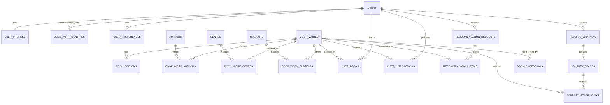

~# Database Schema — The Reading Compass

**Document version:** 1.1  
**Status:** Finalized for MVP architecture; implementation details remain subject to migration review  
**Last updated:** 2026-10-31

---

## 1. Purpose

This document defines the proposed PostgreSQL data model for **The Reading Compass**, an AI-powered reading companion that supports:

- User accounts and reading preferences
- A work-level book catalogue with optional edition records
- Personal libraries, TBR lists, reading progress, and ratings
- Search and personalized recommendations
- Reading journeys and their stages
- Feedback and interaction history
- Book embeddings for semantic retrieval

The schema is designed for an MVP that can evolve without prematurely introducing microservices or a separate vector database.

## 2. Finalized design decisions

The following decisions were confirmed during schema review.

| Decision | Selected approach | Schema implication |
|---|---|---|
| Rating scale | 1–5 stars | Store ratings as numeric values from 1.0 to 5.0 |
| Reading progress | Pages and percentage | Store `current_page`, `total_pages`, and `progress_percent` |
| Embedding dimension | 384 | Use `VECTOR(384)` for book embeddings |
| Authentication | Email/password + Google OAuth | Support multiple authentication identities per user |
| Book identity | Work-level | Personal library entries reference a book work; edition is optional |
| Search | Hybrid | Combine PostgreSQL full-text search and trigram matching |

These are product-level decisions. Exact model revision, search-language configuration, and some operational policies are implementation details to validate.

## 3. Database technology

**Primary database:** PostgreSQL  
**Vector search:** pgvector  
**Fuzzy text matching:** pg_trgm

Required extensions:

```sql
CREATE EXTENSION IF NOT EXISTS vector;
CREATE EXTENSION IF NOT EXISTS pg_trgm;
```

PostgreSQL remains the source of truth for relational data. pgvector stores and searches semantic embeddings without requiring a separate vector database for the MVP.

## 4. Entity relationship overview

The principal relationships are:

- A `users` row owns one `user_profiles` row.
- A user can have multiple `user_auth_identities` (for example, Google OAuth and password-based login).
- A `book_work` can have multiple `book_editions`.
- A work can have multiple authors, genres, and subjects through join tables.
- A user can have many `user_books` entries, each connecting the user to a work.
- A user can generate many `recommendation_requests`; each request can return multiple `recommendation_items`.
- A user can create multiple `reading_journeys`; each journey contains ordered stages and selected books.
- A work can have one or more versioned embeddings.



The diagram is conceptual. The SQL-level constraints and indexes should be implemented through versioned migrations.

## 5. Core account and preference tables

### 5.1 `users`

Stores the application account.

| Column | Type | Rules / purpose |
|---|---|---|
| `id` | UUID | Primary key |
| `email` | CITEXT or VARCHAR | Unique, normalized email |
| `display_name` | VARCHAR(120) | User-facing name |
| `password_hash` | TEXT, nullable | Present for password login; null for OAuth-only accounts |
| `email_verified_at` | TIMESTAMPTZ, nullable | Verification timestamp |
| `status` | VARCHAR(20) | For example: `active`, `pending`, `disabled` |
| `created_at` | TIMESTAMPTZ | Creation time |
| `updated_at` | TIMESTAMPTZ | Last update |

Use a case-insensitive unique email strategy. If `CITEXT` is selected, enable the extension; otherwise normalize email consistently in the application and enforce uniqueness on the normalized value.

### 5.2 `user_auth_identities`

Stores external authentication identities, including Google OAuth.

| Column | Type | Rules / purpose |
|---|---|---|
| `id` | UUID | Primary key |
| `user_id` | UUID | FK → `users.id` |
| `provider` | VARCHAR(30) | For example: `google`, `password` |
| `provider_subject` | VARCHAR(255) | Stable provider-side user identifier |
| `provider_email` | VARCHAR(320), nullable | Email reported by provider |
| `created_at` | TIMESTAMPTZ | Link creation time |

Constraints:

- Unique (`provider`, `provider_subject`).
- A user may link multiple providers.
- Never use a mutable display name as the OAuth identity key.
- Account linking must verify ownership of both identities; do not automatically merge accounts solely because email strings match.

For a password-based account, the password hash can remain on `users` or be represented as a `password` identity. Keep one approach consistent in implementation. The proposed MVP uses `users.password_hash` for password login and `user_auth_identities` for external providers.

### 5.3 `user_profiles`

Stores relatively stable reader-profile information.

| Column | Type | Rules / purpose |
|---|---|---|
| `user_id` | UUID | Primary key and FK → `users.id` |
| `reader_level` | VARCHAR(30) | Beginner, casual, avid, or knowledge-oriented |
| `preferred_language` | VARCHAR(12) | Preferred content language |
| `bio` | TEXT, nullable | Optional user-provided context |
| `created_at` | TIMESTAMPTZ | Creation time |
| `updated_at` | TIMESTAMPTZ | Last update |

Avoid storing sensitive inferences about users. Reader-level and interest information should be user-provided or transparently editable.

### 5.4 `user_preferences`

Stores explicit, editable preferences. A row can represent a preference category/value pair.

| Column | Type | Rules / purpose |
|---|---|---|
| `id` | UUID | Primary key |
| `user_id` | UUID | FK → `users.id` |
| `preference_type` | VARCHAR(40) | For example: `genre`, `subject`, `language`, `length`, `difficulty`, `goal` |
| `preference_value` | TEXT | Selected value |
| `preference_weight` | NUMERIC(4,3) | Optional strength, constrained to 0–1 |
| `source` | VARCHAR(20) | `onboarding` or `user_edit` |
| `created_at` | TIMESTAMPTZ | Creation time |
| `updated_at` | TIMESTAMPTZ | Last update |

Use a unique constraint appropriate to the chosen preference model, such as (`user_id`, `preference_type`, `preference_value`). Keep explicit preferences distinct from inferred preferences so the user can inspect and override them.

## 6. Book catalogue

### 6.1 `book_works`

Represents a book work rather than a particular physical or digital edition. This is the canonical book identity used for recommendations and personal-library tracking.

| Column | Type | Rules / purpose |
|---|---|---|
| `id` | UUID | Primary key |
| `canonical_title` | VARCHAR(500) | Required normalized title |
| `subtitle` | VARCHAR(500), nullable | Subtitle |
| `description` | TEXT, nullable | Curated or provider description |
| `original_language` | VARCHAR(12), nullable | Original language where known |
| `first_published_year` | SMALLINT, nullable | Approximate first publication year |
| `difficulty_level` | VARCHAR(30), nullable | Optional curated reading difficulty |
| `estimated_reading_minutes` | INTEGER, nullable | Optional estimate |
| `cover_image_url` | TEXT, nullable | Preferred cover image |
| `metadata_status` | VARCHAR(20) | For example: `verified`, `unverified`, `needs_review` |
| `created_at` | TIMESTAMPTZ | Creation time |
| `updated_at` | TIMESTAMPTZ | Last update |

Do not assume that provider records with similar titles always refer to the same work. Catalogue ingestion needs a deduplication and review strategy.

### 6.2 `book_editions`

Stores edition-specific metadata while preserving the work-level identity.

| Column | Type | Rules / purpose |
|---|---|---|
| `id` | UUID | Primary key |
| `work_id` | UUID | FK → `book_works.id` |
| `isbn_10` | VARCHAR(10), nullable | Edition ISBN-10 |
| `isbn_13` | VARCHAR(13), nullable | Edition ISBN-13 |
| `publisher` | VARCHAR(255), nullable | Publisher |
| `publication_date` | DATE, nullable | Edition publication date |
| `page_count` | INTEGER, nullable | Edition page count |
| `format` | VARCHAR(30), nullable | Paperback, hardcover, ebook, audiobook, etc. |
| `language` | VARCHAR(12), nullable | Edition language |
| `cover_image_url` | TEXT, nullable | Edition cover |
| `created_at` | TIMESTAMPTZ | Creation time |

Add partial unique indexes for non-null ISBN values. Page count belongs to an edition because different editions can have different pagination.

### 6.3 `authors`

| Column | Type | Rules / purpose |
|---|---|---|
| `id` | UUID | Primary key |
| `name` | VARCHAR(255) | Author display name |
| `normalized_name` | VARCHAR(255) | Deduplication/search value |
| `bio` | TEXT, nullable | Optional biography |
| `created_at` | TIMESTAMPTZ | Creation time |

### 6.4 `book_work_authors`

Join table for the many-to-many relationship between works and authors.

| Column | Type | Rules / purpose |
|---|---|---|
| `work_id` | UUID | FK → `book_works.id` |
| `author_id` | UUID | FK → `authors.id` |
| `author_role` | VARCHAR(30) | Author, editor, translator, etc. |
| `display_order` | SMALLINT | Order shown in catalogue |

Primary key: (`work_id`, `author_id`, `author_role`).

### 6.5 `genres` and `book_work_genres`

`genres` stores controlled genre labels. `book_work_genres` links works to genres.

Suggested `genres` columns:

- `id` UUID primary key
- `name` VARCHAR(100) unique
- `slug` VARCHAR(120) unique

Suggested `book_work_genres` columns:

- `work_id` UUID FK
- `genre_id` UUID FK
- `source` VARCHAR(20), such as `provider`, `curated`, or `user`
- Composite primary key (`work_id`, `genre_id`)

### 6.6 `subjects` and `book_work_subjects`

Subjects represent topics and knowledge areas, such as economics, psychology, leadership, or quantum computing. They are more granular than broad genres and support goal-oriented reading journeys.

Suggested `subjects` columns:

- `id` UUID primary key
- `name` VARCHAR(150) unique
- `slug` VARCHAR(170) unique
- `description` TEXT, nullable
- `parent_subject_id` UUID nullable FK → `subjects.id`

Suggested `book_work_subjects` columns:

- `work_id` UUID FK
- `subject_id` UUID FK
- `relevance_weight` NUMERIC(4,3), optional 0–1
- `source` VARCHAR(20)
- Composite primary key (`work_id`, `subject_id`)

### 6.7 `subject_prerequisites`

Represents optional prerequisite relationships between subjects.

| Column | Type | Rules / purpose |
|---|---|---|
| `subject_id` | UUID | FK → `subjects.id` |
| `prerequisite_subject_id` | UUID | FK → `subjects.id` |
| `strength` | NUMERIC(4,3) | Optional confidence/importance from 0–1 |
| `notes` | TEXT, nullable | Explanation |

Primary key: (`subject_id`, `prerequisite_subject_id`). Add a check preventing a subject from being its own prerequisite. Validate the graph for cycles in application logic or a data-quality job.

## 7. External catalogue identifiers and provenance

### 7.1 `book_external_ids`

Maps provider records to canonical works.

| Column | Type | Rules / purpose |
|---|---|---|
| `id` | UUID | Primary key |
| `work_id` | UUID | FK → `book_works.id` |
| `provider` | VARCHAR(40) | For example: `google_books`, `open_library` |
| `provider_item_id` | VARCHAR(255) | Provider's stable identifier |
| `provider_url` | TEXT, nullable | Source record URL |
| `last_synced_at` | TIMESTAMPTZ, nullable | Last successful sync |
| `created_at` | TIMESTAMPTZ | Creation time |

Unique (`provider`, `provider_item_id`).

### 7.2 `book_metadata_sources`

Optional provenance table for fields or catalogue snapshots that need traceability.

Suggested columns:

- `id` UUID primary key
- `work_id` UUID FK
- `provider` VARCHAR(40)
- `field_name` VARCHAR(100)
- `source_value` JSONB
- `retrieved_at` TIMESTAMPTZ
- `is_verified` BOOLEAN default false

For the MVP, a simpler provider-sync log may be enough. Avoid building a complex field-level provenance system until metadata conflicts become a real operational problem.

## 8. Personal library and reading activity

### 8.1 `user_books`

Connects a user to a work and stores their personal reading state.

| Column | Type | Rules / purpose |
|---|---|---|
| `id` | UUID | Primary key |
| `user_id` | UUID | FK → `users.id` |
| `work_id` | UUID | FK → `book_works.id` |
| `edition_id` | UUID, nullable | Optional FK → `book_editions.id` |
| `status` | VARCHAR(20) | `want_to_read`, `currently_reading`, `completed`, `paused`, `abandoned` |
| `rating` | NUMERIC(2,1), nullable | 1.0–5.0 |
| `current_page` | INTEGER, nullable | Current page reached |
| `total_pages` | INTEGER, nullable | Page count for selected edition |
| `progress_percent` | NUMERIC(5,2) | 0–100 |
| `started_at` | DATE, nullable | Reading start date |
| `completed_at` | DATE, nullable | Completion date |
| `notes` | TEXT, nullable | Private user notes |
| `created_at` | TIMESTAMPTZ | Creation time |
| `updated_at` | TIMESTAMPTZ | Last update |

Constraints and behavior:

- Unique (`user_id`, `work_id`) for one personal entry per work.
- `rating` must be null or between 1.0 and 5.0.
- `current_page` and `total_pages` must be non-negative when present.
- `current_page` must not exceed `total_pages` when both are present.
- `progress_percent` must be between 0 and 100.
- Calculate or validate percentage from pages in backend logic when page counts are available.
- When page counts are unavailable, allow percentage-based progress.
- Decide whether ratings permit whole stars, half stars, or one-decimal values in the product UI; the schema supports one decimal place.

The selected work-level identity avoids duplicate personal-library entries for different editions of the same book. The optional edition link preserves pagination and format context.

### 8.2 `user_interactions`

Records user actions that can inform personalization and analytics.

| Column | Type | Rules / purpose |
|---|---|---|
| `id` | UUID | Primary key |
| `user_id` | UUID | FK → `users.id` |
| `work_id` | UUID, nullable | FK → `book_works.id` |
| `interaction_type` | VARCHAR(40) | For example: `view`, `click`, `save`, `dismiss`, `rate`, `start`, `complete`, `abandon` |
| `rating_value` | NUMERIC(2,1), nullable | Relevant for rating events |
| `context` | JSONB | Optional source/context, such as recommendation request |
| `created_at` | TIMESTAMPTZ | Event time |

Store events rather than overwriting the history of user behavior. Do not interpret every event as a definitive preference: for example, abandoning a book may reflect timing rather than dislike.

### 8.3 `reading_goals`

Optional table for explicit user goals.

Suggested columns:

- `id` UUID primary key
- `user_id` UUID FK
- `title` VARCHAR(160)
- `description` TEXT, nullable
- `goal_type` VARCHAR(40), such as `learn_subject`, `read_more`, `explore_genre`
- `target_date` DATE nullable
- `status` VARCHAR(20)
- `created_at` and `updated_at` TIMESTAMPTZ

A goal may be used to generate a reading journey or a context-specific recommendation request.

## 9. Recommendation records

### 9.1 `recommendation_requests`

Stores the context and configuration for a recommendation run.

| Column | Type | Rules / purpose |
|---|---|---|
| `id` | UUID | Primary key |
| `user_id` | UUID | FK → `users.id` |
| `request_type` | VARCHAR(40) | `next_read`, `discover`, `tbr_priority`, `goal_based`, etc. |
| `request_context` | JSONB | User prompt, goal, filters, or context |
| `algorithm_version` | VARCHAR(40) | Version of ranking configuration |
| `created_at` | TIMESTAMPTZ | Request time |

### 9.2 `recommendation_items`

Stores the ordered results for a request.

| Column | Type | Rules / purpose |
|---|---|---|
| `id` | UUID | Primary key |
| `request_id` | UUID | FK → `recommendation_requests.id` |
| `work_id` | UUID | FK → `book_works.id` |
| `rank_position` | INTEGER | 1-based rank |
| `score` | NUMERIC(8,6) | Final ranking score |
| `score_breakdown` | JSONB | Component scores and weights |
| `reason_codes` | JSONB | Structured explanation reasons |
| `created_at` | TIMESTAMPTZ | Creation time |

Constraints:

- Unique (`request_id`, `work_id`).
- Unique (`request_id`, `rank_position`).
- Keep score components and algorithm version so results can be audited and compared.
- Explanations shown to users should be grounded in these reason codes and catalogue metadata.

## 10. Reading journeys

### 10.1 `reading_journeys`

| Column | Type | Rules / purpose |
|---|---|---|
| `id` | UUID | Primary key |
| `user_id` | UUID | FK → `users.id` |
| `goal_id` | UUID, nullable | FK → `reading_goals.id` |
| `title` | VARCHAR(200) | Journey title |
| `description` | TEXT, nullable | Journey summary |
| `status` | VARCHAR(20) | `draft`, `active`, `completed`, `archived` |
| `created_at` | TIMESTAMPTZ | Creation time |
| `updated_at` | TIMESTAMPTZ | Last update |

### 10.2 `journey_stages`

Represents ordered learning or reading stages.

| Column | Type | Rules / purpose |
|---|---|---|
| `id` | UUID | Primary key |
| `journey_id` | UUID | FK → `reading_journeys.id` |
| `title` | VARCHAR(200) | Stage title |
| `description` | TEXT, nullable | Stage objective |
| `stage_order` | INTEGER | Position in journey |
| `subject_id` | UUID, nullable | FK → `subjects.id` |
| `status` | VARCHAR(20) | `locked`, `available`, `in_progress`, `completed` |
| `created_at` | TIMESTAMPTZ | Creation time |

Unique (`journey_id`, `stage_order`).

### 10.3 `journey_stage_books`

Links suggested works to a stage.

| Column | Type | Rules / purpose |
|---|---|---|
| `id` | UUID | Primary key |
| `stage_id` | UUID | FK → `journey_stages.id` |
| `work_id` | UUID | FK → `book_works.id` |
| `selection_order` | INTEGER | Display order |
| `is_required` | BOOLEAN | Whether the book is essential or optional |
| `selection_reason` | TEXT, nullable | Why this book was selected |

Unique (`stage_id`, `work_id`).

## 11. Book embeddings

### 11.1 `book_embeddings`

Stores semantic representations at the work level.

| Column | Type | Rules / purpose |
|---|---|---|
| `id` | UUID | Primary key |
| `work_id` | UUID | FK → `book_works.id` |
| `model_name` | VARCHAR(160) | Embedding model identifier |
| `model_revision` | VARCHAR(160) | Pinned model revision |
| `embedding` | VECTOR(384) | 384-dimensional vector |
| `source_text_hash` | VARCHAR(128) | Hash of the exact input text |
| `created_at` | TIMESTAMPTZ | Generation time |

Suggested initial candidate: `sentence-transformers/all-MiniLM-L6-v2`, which produces 384-dimensional embeddings. Treat this as a candidate, not a permanent commitment: benchmark retrieval quality, multilingual behavior, latency, and hosting cost before generating the full catalogue. Pin the exact model revision used in production.

Recommendations:

- Generate embeddings for works, not every edition.
- Build the embedding input from useful work-level fields such as title, subtitle, description, authors, genres, and subjects.
- Normalize and version the input construction process.
- Regenerate an embedding when the source text or model revision changes.
- Keep old model versions only if needed for migration, comparison, or rollback.

Example index (choose parameters after measuring catalogue size and query behavior):

```sql
CREATE INDEX book_embeddings_vector_idx
ON book_embeddings
USING hnsw (embedding vector_cosine_ops);
```

Use a uniqueness policy such as (`work_id`, `model_name`, `model_revision`, `source_text_hash`) to avoid duplicate generation of the same representation.

## 12. Hybrid search design

The MVP uses PostgreSQL search rather than introducing a separate search service.

### Full-text search

Maintain a `tsvector` search document for searchable catalogue text and index it with GIN. The document can include title, subtitle, description, author names, genre labels, and subject labels.

### Trigram matching

Use `pg_trgm` for fuzzy matching of titles and author names, including misspellings and partial matches. Add GIN or GiST indexes to the fields and query patterns that need it.

### Semantic retrieval

Use pgvector cosine distance to retrieve works semantically similar to a reader query or reader profile vector.

### Important implementation note

PostgreSQL generated columns cannot aggregate values from related tables. Since author and subject names live in separate tables, the combined search document must be maintained through one of these approaches:

1. A denormalized search-document column updated by application services or database triggers.
2. A materialized view refreshed according to an explicit freshness policy.
3. Joined search queries for the initial small catalogue.

For the MVP, prefer the simplest reliable approach and add indexes after checking query plans with realistic data.

## 13. Important indexes and constraints

The exact migration set should be based on query patterns, but likely indexes include:

- Unique normalized user email.
- Unique (`provider`, `provider_subject`) on `user_auth_identities`.
- Unique (`user_id`, `work_id`) on `user_books`.
- Index `user_books(user_id, status)`.
- Index `user_interactions(user_id, created_at DESC)`.
- Index `recommendation_requests(user_id, created_at DESC)`.
- Unique (`request_id`, `rank_position`) on `recommendation_items`.
- Unique (`provider`, `provider_item_id`) on `book_external_ids`.
- Partial unique indexes on non-null ISBN-10 and ISBN-13.
- GIN index on the full-text search vector.
- Trigram index on normalized title and author search fields.
- HNSW or IVFFlat vector index after measuring catalogue size and recall/latency tradeoffs.
- Index foreign-key columns used frequently in joins and deletes.

Add database-level checks for rating, progress, page counts, and valid status values where practical. Use foreign-key deletion behavior deliberately; avoid cascading deletion of shared catalogue works when a user account is deleted.

## 14. Data integrity and lifecycle rules

1. **Work deduplication:** external provider records must be matched to canonical works before creating duplicates. ISBN is edition-level evidence, not a universal work identifier.
2. **Edition consistency:** an edition linked from `user_books` must belong to the same work as that `user_books.work_id`; validate this in application logic or enforce it with a carefully designed composite foreign key.
3. **Progress consistency:** calculate percentage from page values when possible; validate bounds server-side.
4. **Rating consistency:** accept only values in the 1–5 range and apply the product's chosen step size.
5. **Recommendation auditability:** persist algorithm version, score breakdown, and reason codes.
6. **User deletion:** define an account-deletion workflow that removes or anonymizes personal data while retaining only catalogue data that is lawful and necessary to retain.
7. **Metadata provenance:** distinguish provider-supplied metadata from curated or user-contributed values.
8. **Privacy:** keep private notes and reading activity private by default. Do not expose user activity to other users without explicit product consent.

## 15. What is intentionally out of scope for the MVP

- Separate microservice databases.
- A dedicated vector database.
- Neo4j or a graph database; subject relationships can initially live in PostgreSQL.
- Collaborative-filtering tables and model pipelines before sufficient interaction volume exists.
- Complex social features, public reviews, and follower graphs.
- A highly granular event warehouse.
- Full edition-level inventory management.

These can be introduced later if product usage demonstrates a real need.

## 16. Migration and implementation order

Recommended migration sequence:

1. Enable required PostgreSQL extensions.
2. Create users, profiles, authentication identities, and preferences.
3. Create catalogue tables: works, editions, authors, genres, subjects, and join tables.
4. Create external IDs and metadata provenance tables.
5. Create personal library, goals, and interaction tables.
6. Create recommendation request and item tables.
7. Create reading journey tables.
8. Create embedding storage and vector indexes.
9. Add search-document maintenance and full-text/trigram indexes.
10. Add constraints, seed controlled vocabularies, and test migration rollback.

Use a migration tool such as Alembic. Keep schema changes version-controlled and test both a clean database setup and upgrades from the previous migration.

## 17. Open implementation details

The following items do not change the agreed product-level schema but must be settled during implementation:

- Pin and benchmark the exact 384-dimensional embedding model revision.
- Decide whether ratings use whole stars, half stars, or one-decimal increments.
- Select text-search configurations for the languages supported in the MVP.
- Choose the search-document maintenance strategy.
- Define exact deletion/retention behavior for user activity and assistant conversations.
- Define catalogue deduplication and conflict-resolution rules.
- Measure vector-index performance and choose HNSW/IVFFlat settings based on real data.
- Decide whether `reading_goals` is required for the first MVP release or can be introduced with journeys.

## 18. Final review checklist

- [x] Rating scale: 1–5 stars
- [x] Progress: pages and percentage
- [x] Embedding dimension: 384
- [x] Authentication: email/password plus Google OAuth
- [x] Book identity: work-level with optional edition link
- [x] Search: PostgreSQL full-text plus trigram matching, with semantic retrieval supported by pgvector
- [x] MVP uses PostgreSQL as the primary relational and vector store
- [ ] Exact embedding model revision benchmarked and pinned
- [ ] Search-language configuration tested
- [ ] Migration and deletion policies implemented and tested

---

**Document owner:** The Reading Compass project  
**Related documents:** `PRD.md`, `SYSTEM_ARCHITECTURE.md`, `RECOMMENDATION_ENGINE.md`  
**Implementation note:** Treat this document as the approved schema design baseline. The actual database migrations are the executable source of truth once implementation begins.
