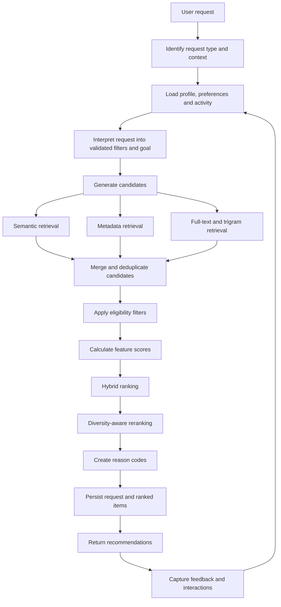

# Recommendation Engine — The Reading Compass

**Document version:** 1.1  
**Status:** Finalized for MVP design  
**Last updated:** 2026-11-01

---

## 1. Purpose

The recommendation engine is the core personalization system of **The Reading Compass**. It should help a reader decide what to read next, prioritize books already in their TBR list, discover relevant books outside their usual interests, and build structured reading journeys around learning goals.

The engine must be more than an LLM prompt that returns book titles. It should use catalogue data, reader preferences, interaction history, semantic retrieval, explicit ranking features, and measurable evaluation.

**Core separation of responsibilities:**

- The recommendation engine retrieves, filters, scores, ranks, and diversifies books.
- The LLM helps interpret natural-language requests, structure reading goals, and explain recommendations using evidence supplied by the engine.
- The database stores catalogue data, reader activity, recommendation results, and algorithm versions.

The LLM must not invent catalogue entries or independently decide the final ranking.

## 2. Confirmed design decisions

The following choices were confirmed during review and are the approved MVP defaults:

| Area | Final decision | Implementation direction |
|---|---|---|
| Initial ranking | Hybrid weighted scoring baseline | Combine normalized semantic, goal, topic, author, difficulty, and novelty signals using configurable weights |
| Diversity | MMR + soft author/genre limits | Apply Maximal Marginal Relevance after relevance ranking; do not force diversity when the request is narrow |
| Reader profile | Hybrid profile | Combine explicit onboarding preferences, behavioral signals, and embeddings; explicit preferences carry greater weight initially |
| Journey sequencing | Subject prerequisite DAG | Represent subject dependencies as a directed acyclic graph and use topological ordering where relationships are reliable |
| Feedback updates | Incremental/deterministic | Update reader-profile features from recorded interactions without retraining a model after every event |

These are the approved MVP design choices. The numerical ranking weights, MMR parameter, interaction weights, and confidence thresholds remain configurable hyperparameters to be evaluated and tuned; confirming the approach does not mean the initial numeric values are empirically validated.

## 2. Goals and non-goals

### 2.1 Goals

1. Recommend books relevant to a reader's interests, goals, reading level, and context.
2. Provide useful recommendations even when a user has little or no interaction history.
3. Prioritize a user's existing TBR list when requested.
4. Balance relevance with diversity, novelty, and discovery.
5. Explain why each book was recommended using traceable signals.
6. Improve personalization from explicit feedback and observed interactions.
7. Support goal-oriented reading journeys with sensible progression.
8. Evaluate recommendation quality using offline metrics and beta-user feedback.

### 2.2 Non-goals for the MVP

- Training a large recommendation model from scratch.
- Collaborative filtering that depends on a large user base.
- Automatically treating popularity as quality.
- Letting an LLM fabricate books, metadata, ratings, or availability.
- Claiming that a reading sequence is academically authoritative when prerequisite data is incomplete.
- Building a complex real-time streaming recommendation platform.

## 3. Recommendation use cases

| Use case | Input | Expected behavior |
|---|---|---|
| What should I read next? | Reader profile, current goal, library, recent activity | Recommend a balanced shortlist |
| Discover something new | Interests plus exploration preference | Include relevant books beyond familiar genres/authors |
| Prioritize my TBR | Existing TBR list and current goal/context | Rank only books already in the TBR list |
| Recommend for a goal | Goal such as learning economics | Retrieve and rank books relevant to the goal |
| Recommend by mood | Natural-language mood or desired experience | Translate request into validated search features |
| Find a new author | Authors already read/liked | Recommend relevant works by authors not yet explored |
| Build a reading journey | Learning goal and reader level | Create ordered stages with books for each stage |

## 4. Inputs and outputs

### 4.1 Inputs

The engine may use:

- Explicit onboarding preferences: genres, subjects, languages, preferred length, reading level, and goals.
- Reader profile: beginner, casual, avid, or knowledge-oriented.
- Personal library: want-to-read, currently reading, completed, paused, and abandoned works.
- Ratings and feedback: likes, dislikes, saves, dismissals, and ratings.
- Interaction events: views, clicks, starts, progress updates, and completions.
- Current request context: next-read, discovery, TBR prioritization, goal-based, mood-based, or author discovery.
- Catalogue metadata: title, description, authors, genres, subjects, language, publication details, difficulty, and page count where available.
- Book embeddings: 384-dimensional work-level vectors.

Not every field will be available for every book or reader. Missing metadata must be handled explicitly rather than silently treated as a negative signal.

### 4.2 Output

A recommendation response should include:

- Recommended work ID and display metadata.
- Rank position.
- Final score and optional component-score breakdown.
- Structured reason codes.
- Algorithm/configuration version.
- Optional warnings where metadata is incomplete.

The API should return a stable, explainable result rather than only a list of titles.

## 5. Book representation

Each book work should have a structured catalogue representation and a semantic representation.

### 5.1 Structured features

Potential features include:

- Genres and subjects.
- Author IDs.
- Language.
- Reading difficulty, if curated or reliably sourced.
- Page count or estimated length, preferably edition-aware.
- Publication period.
- Metadata quality/completeness.
- Prerequisite subject relationships, where available.

Use normalized IDs for authors, genres, and subjects. Avoid relying only on raw text labels because spelling variations and inconsistent provider metadata can fragment the catalogue.

### 5.2 Semantic text document

Create a consistent text document for each work using selected fields, for example:

```text
Title: Thinking, Fast and Slow
Authors: Daniel Kahneman
Description: An exploration of how human thinking uses fast intuitive
and slower deliberate processes.
Genres: Nonfiction, Psychology
Subjects: Cognitive psychology, Decision-making, Behavioral economics
Language: English
```

The exact fields and formatting should be versioned. Do not include noisy or unverified metadata simply because it is available.

### 5.3 Embeddings

The database schema specifies 384 dimensions. An initial candidate is:

`sentence-transformers/all-MiniLM-L6-v2`

This is a candidate model, not an irreversible choice. Benchmark it on representative catalogue descriptions and real search queries before generating embeddings at scale.

Store:

- Work ID.
- Model name and pinned revision (explicitly unset/None during initial setup until verified and benchmarked).
- Embedding vector (`VECTOR(384)`).
- Hash of the source text used to generate it.
- `is_active` boolean flag (`default=true`).
- Generation timestamp.

**Version lifecycle & active filtering:**
- A partial unique index `(work_id, model_name, model_revision) WHERE is_active = true` ensures at most one active vector per work and model revision (a work may have zero active vectors if embedding generation is pending or deactivated).
- When generating a replacement embedding, deactivate the previous version (`is_active = false`) within the same transaction.
- Recommendation retrieval must strictly filter to active embeddings (`WHERE is_active = true`).

Generate embeddings at the work level, not separately for every edition. Regenerate when the source document or model revision changes.

### 5.4 Metadata quality

A book with missing description, language, or subject tags should not automatically receive a poor relevance score. Track metadata completeness and use it to:

- Reduce confidence in affected features.
- Avoid generating unsupported explanations.
- Identify catalogue records that need enrichment or review.

## 6. Reader representation

A reader representation combines explicit preferences and behavioral signals. It should be transparent, updateable, and robust to sparse data.

### 6.1 Explicit reader profile

Start with onboarding choices:

- Favorite genres and subjects.
- Topics the reader wants to learn.
- Preferred languages.
- Preferred book length.
- Self-described reading level.
- Current goals.
- Authors or books they already enjoy, if supplied.

Explicit preferences should have higher trust than weak inferred signals. Users must be able to edit or remove them.

### 6.2 Interaction signals and signal-source precedence

Store events in `user_interactions`. Initial signal strengths and precedence rules are established to extract clean, un-distorted reader preferences.

#### 6.2.1 Configured signal weights and polarities

| Interaction identifier | Weight | Polarity | Description / Authority |
|---|---|---|---|
| `rate_5` | `+1.00` | Positive | Authoritative 5-star rating from `book_ratings` |
| `rate_4` | `+0.75` | Positive | Authoritative 4-star rating from `book_ratings` |
| `rate_3` | `+0.10` | Neutral | Authoritative 3-star rating (neutral/topic signal) |
| `rate_2` | `-0.40` | Negative | Authoritative 2-star rating from `book_ratings` |
| `rate_1` | `-0.80` | Negative | Authoritative 1-star rating from `book_ratings` |
| `recommendation_helpful` | `+0.50` | Positive | Explicit helpful feedback from `recommendation_items` |
| `recommendation_not_helpful`| `-0.40` | Negative | Explicit not-helpful feedback from `recommendation_items` |
| `save` | `+0.60` | Positive | Active TBR shelf in `user_books` (`want_to_read`) |
| `complete` | `+0.50` | Positive | Terminal completed reading lifecycle in `user_books` |
| `start` | `+0.30` | Positive | Active `currently_reading` or `paused` in `user_books` |
| `progress` | `+0.25` | Positive | Reading progress milestone |
| `abandon` | `-0.20` | Negative | Abandoned book in `user_books` (unless restarted) |
| `dismiss` | `-0.15` | Negative | Work-specific dismissal (unless superseded by positive action) |
| `recommendation_click` | `+0.15` | Positive | Clicked recommended book details (passive) |
| `click` | `+0.10` | Positive | Clicked catalogue book details (passive) |
| `view` | `+0.05` | Positive | Viewed book card or details page (passive) |

#### 6.2.2 Work-level precedence hierarchy

A reader may interact with a work through multiple orthogonal families (e.g., rating, reading progress, recommendation feedback, library shelving). The vector builder requires exactly one resolved behavioral signal per work. Rather than applying non-linear or additive summing that distorts calibrated weights, the system enforces **deterministic priority selection**:

$$\text{Rating} \succ \text{Reading Lifecycle} \succ \text{Recommendation Feedback} \succ \text{Library Save (TBR)} \succ \text{Passive Browsing}$$

1. **Rating family precedence:**
   - `BookRating` (`uq_book_ratings_user_work`) is the sole authoritative state of a user's current rating.
   - Historical `rate` interactions for that work are superseded and not double-counted.
   - A non-neutral rating ($1, 2, 4, 5$ stars) strictly supersedes all lower-priority families (Lifecycle, Feedback, Save, Passive).
2. **Neutral-rating exception:**
   - A 3-star rating (`rate_3`, `+0.10`) is neutral for directional vector construction and preserved as a neutral/topic-only signal.
   - It **must not suppress** a non-neutral signal from a lower-priority family (e.g. a `completed` reading lifecycle at `+0.50` or `recommendation_helpful` at `+0.50`). In such cases, the non-neutral signal becomes the primary `ResolvedWorkSignal`, while the 3-star rating is retained in `neutral_signals`.
   - When a 3-star rating is the sole explicit signal for a work, it resolves as the work's primary signal with `polarity="neutral"`.
3. **Reading lifecycle resolution:**
   - Active `UserBook` status (`completed`, `currently_reading`, `paused`, `abandoned`) and `ReadingProgress` determine lifecycle state.
   - **Terminal completion dominance:** `status == 'completed'` (`+0.50`) represents the culmination of the reading attempt and subsumes earlier `start` (`+0.30`) and `progress` (`+0.25`) events.
   - **Paused state:** `status == 'paused'` resolves to the lifecycle family with in-progress weight `start` (`+0.30`). It is not treated as a TBR save and does not inherit prior abandonment. Timestamp is evaluated as `progress.last_read_at`, falling back to `user_book.updated_at`.
   - **Abandonment and restart:** An abandonment signal (`-0.20`) applies if `status == 'abandoned'` and no later restart occurred. A subsequent restart (`currently_reading`, `completed`, or a later `start` interaction) completely supersedes the earlier abandonment.
4. **Library save (TBR):**
   - `UserBook.status == 'want_to_read'` represents an active TBR bookmark (`+0.60`). If the book transitions to active reading or completion, the save is subsumed by the Lifecycle family.
5. **Dismissals and supersession:**
   - Work-specific dismissals carry weight `-0.15` (negative). They never penalize authors, subjects, or entire genres.
   - If a reader subsequently takes an explicit positive action (saving to TBR, starting reading, or rating $\ge 4$), the subsequent positive action completely supersedes and cancels the dismissal.
6. **Passive interaction ceiling and suppression:**
   - If any explicit signal (Rating, Lifecycle, Recommendation Feedback, TBR Save, Dismissal) exists for a work, all passive events (`recommendation_click`, `click`, `view`) are **completely suppressed**.
   - If only passive events exist for a work, the single strongest event wins deterministically (`recommendation_click` `+0.15` > `click` `+0.10` > `view` `+0.05`). Repeated views and clicks are **never summed**.

#### 6.2.3 Passive throttling window

To prevent rapid browsing, page refreshes, and repetitive clicks from distorting watermark activity counters, passive events (`view`, `click`, `recommendation_click`) on the same `(user_id, work_id)` apply a **1-hour anchor-based sliding cooldown** (`PASSIVE_THROTTLING_WINDOW_SECONDS = 3600.0`):
- When a passive event is accepted, an anchor timestamp is recorded for that work.
- Subsequent passive events on the same work occurring within 1 hour ($< 3600\text{s}$) of the anchor are throttled and do not advance the anchor.
- The next passive event occurring $\ge 1\text{ hour}$ after the anchor is accepted and resets the anchor. This prevents starvation while suppressing burst browsing.

### 6.3 Reader interest vector

For a reader with enough interaction history, a simple initial profile vector can be formed from book embeddings:

\[
p_u = \operatorname{normalize}\left(
\sum_{i \in P_u} w_i e_i -
\alpha \sum_{j \in N_u} v_j e_j
\right)
\]

Where:

- \(e_i\) is a book embedding.
- \(P_u\) is the set of positive interactions.
- \(N_u\) is the set of sufficiently clear negative interactions.
- \(w_i\) and \(v_j\) are interaction weights.
- \(\alpha\) controls the influence of negative feedback.
- `normalize` scales the resulting vector to unit length.

This is a baseline, not a claim that one vector captures a reader's entire identity. Readers may have several independent interests. The implementation can later maintain separate interest vectors by goal or subject.

Do not subtract weak or ambiguous signals as if they were explicit dislikes.

### 6.4 Combining explicit and inferred preferences & profile caching

For cold-start and early-stage users, combine onboarding preferences with interaction-derived signals:

\[
p_u = \operatorname{normalize}(\beta p_{\text{explicit}} +
(1-\beta)p_{\text{behavioral}})
\]

The value of \(\beta\) should depend on the amount and reliability of behavioral data. Initially, explicit preferences should dominate. As meaningful interactions accumulate, the behavioral component can gain influence.

Keep the source of each preference distinguishable so users can correct inaccurate inferences.

#### Cached reader profile: `user_interest_profiles`

To keep recommendation generation responsive and avoid calculating $p_u$ over historical event streams on every request:

1. **Storage:** The calculated unit vector $p_u$ is stored in `user_interest_profiles.interest_vector` (`VECTOR(384)`), along with `inferred_topics` JSONB and an `interaction_count` watermark.
2. **Watermark definition and event eligibility:**
   `interaction_count` is defined strictly as the number of interactions incorporated into the current profile. An interaction event is **eligible** to count toward the watermark if and only if:
   - **Targeted work:** `work_id IS NOT NULL` (general navigation and onboarding events lacking a work target are excluded).
   - **Supported type whitelist:** Belongs to the 12 approved types (`'rate'`, `'complete'`, `'start'`, `'abandon'`, `'save'`, `'dismiss'`, `'recommendation_helpful'`, `'recommendation_not_helpful'`, `'progress'`, `'recommendation_click'`, `'click'`, `'view'`).
   - **Authoritative rating deduplication:** Historical `rate` interactions that correspond to an active `BookRating` record count exactly once. Orphan `rate` events (where the user subsequently deleted their rating) are excluded.
   - **Authoritative TBR save deduplication:** Historical `save` interactions for a book currently active on the TBR shelf (`UserBook.status == 'want_to_read'`) count once.
   - **Passive throttling window:** Consecutive passive events (`view`, `click`, `recommendation_click`) on the same `(user_id, work_id)` within a 1-hour anchor-based cooldown window (`PASSIVE_THROTTLING_WINDOW_SECONDS = 3600.0`) are treated as a single eligible event.
   - **Distinct lifecycle milestones preserved:** Distinct historical lifecycle milestones (`start`, `progress`, `complete`) count separately toward the watermark because they represent distinct user engagement over time, even though work-level resolution later resolves to terminal completion.
   - **Embedding-agnostic counting:** Events on works that do not yet have compatible embeddings **do count** toward the watermark; subsequent active embedding generation acts as a catalogue-driven refresh trigger.
   - **Shared implementation:** Signal extraction and watermark query use the exact same eligibility logic to prevent counter drift.
3. **Refresh triggers & configurable threshold:**
   - **Interaction threshold:** Evaluated by comparing the number of newly eligible interactions against the processed interaction count (`new_eligible_interactions - interaction_count >= refresh_threshold`). The threshold (e.g. 5+ new events) is configurable to avoid recalculating the profile for every incoming event.
   - **Explicit preference update:** Triggered immediately when a user modifies their genre or subject preferences.
   - **Model revision upgrade / embedding backfill:** Triggered when the catalogue embedding model or revision changes, or when active embeddings are backfilled for works in the reader's library or interaction history.
4. **Asynchronous refresh:** Vector recalculation runs asynchronously or as a background job so that user interactions remain low-latency. If the cached vector is null (cold start) or pending update, candidate retrieval falls back to explicit preference heuristics.
5. **Exact embedding model and revision compatibility:**
   - **Active-only:** Queries filter strictly by `is_active = true`.
   - **Exact matching:** Must match configured `model_name` (`PROFILE_EMBEDDING_MODEL_NAME`) and pinned `model_revision` (`PROFILE_EMBEDDING_MODEL_REVISION`).
   - **At most one active embedding:** Guaranteed by the partial unique index `uq_book_embeddings_active_work` on `(work_id, model_name, model_revision)` WHERE `is_active = true`.
   - **Strict unset revision rule:** An unpinned or unset model revision (`None`) must **never** be treated as a wildcard (`LIKE '%'`) or omitted from the query filter. When `PROFILE_EMBEDDING_MODEL_REVISION` is unset, embedding retrieval is safely bypassed with typed status `revision_unspecified`, falling back to cold-start explicit preference heuristics.
   - **Dimensionality safeguard:** Only embeddings with exactly 384 finite float components and norm $\ge \epsilon$ are accepted.

#### Inferred topics & affinities: `inferred_topics`

Stored in `user_interest_profiles.inferred_topics` as `InferredTopicsPayload` JSONB:
1. **Per-work recency decay before aggregation:** Each eligible work is decayed individually via $w_{\text{decayed}}(w) = w_{\text{base}}(w) \times 2^{-\Delta t_w / \tau}$ ($\tau = 180$ days) before topic summation.
2. **Topic contributions:**
   - Genre: $c(w, g) = w_{\text{decayed}}(w) \times 1.0$.
   - Subject: $c(w, s) = w_{\text{decayed}}(w) \times r(w, s)$, where $r(w, s)$ is `BookWorkSubject.relevance_weight` (defaults to $1.0$ if null).
3. **Max-score normalization:**
   - Raw score: $S(T) = \sum_{w \in W^+(T)} c(w, T)$ across distinct contributing works.
   - Normalized affinity: $A(T) = S(T) / \max_{T'} S(T')$, bounded strictly in $[0.0, 1.0]$. Evaluates safely to $0.0$ if max score is below near-zero epsilon ($\epsilon = 10^{-6}$).
4. **Metadata semantics:**
   - `interaction_count`: Number of distinct contributing works ($|W^+(T)|$).
   - `last_interacted_at`: Latest contributing work signal timestamp (UTC-normalized).
   - Keys: Stable UUID strings (`str(genre_id)`, `str(subject_id)`).
5. **Neutral signal topic exposure:**
   - Neutral signals ($w > 0$, e.g. 3-star ratings) contribute to topic exposure when no primary positive signal exists for that work.
   - Primary positive signals strictly supersede neutral signals; a work never double-counts.
6. **Negative signal isolation and bounding:**
   - Negative signals are strictly isolated and never subtract from genre or subject affinity (dismissals and abandonments do not penalize entire topics).
   - Categorized into `dismissed_work_ids`, `abandoned_work_ids`, `low_rated_work_ids`, and `not_helpful_work_ids` (capped at 50 most recent distinct work IDs each), with `all_negative_work_ids` capped at 100.

#### Profile orchestration & concurrency control

Orchestration is coordinated by `ProfileService`:
1. **Freshness evaluation & trigger classification:**
   Evaluated in `should_refresh_profile(...)` with typed reasons:
   - `initial_profile`: No profile exists or `last_calculated_at` is null.
   - `forced`: Explicit recalculation requested.
   - `model_revision_mismatch`: Configured embedding model or pinned revision changed.
   - `explicit_preference_change`: Detected via SHA-256 hash comparison (`explicit_preference_hash` stored in `inferred_topics["meta"]`), detecting additions, weight edits, and deletions without database triggers.
   - `authoritative_state_change`: Detected via SHA-256 state fingerprint comparison (`authoritative_state_fingerprint` stored in `inferred_topics["meta"]`). Historical rating watermark deduplication intentionally deduplicates ratings per work; consequently, modifying or deleting an existing `BookRating`, changing `UserBook.status` (e.g. from `currently_reading` to `completed`), advancing `ReadingProgress` (`progress_percent`, `last_read_at`), or updating `RecommendationItem` feedback (`feedback_type`, `feedback_at`) does not increase the eligible interaction count. The fingerprint canonically serializes and hashes all active ratings (`R|<work_id>|<rating>`), library books & reading progress (`B|<work_id>|<status>|<progress_percent>|<last_read_at>`), and recommendation feedback (`F|<work_id>|<feedback_type>|<feedback_at>`), detecting any additions, mutations, or deletions.
   - `threshold_reached`: Newly eligible interactions $\ge \text{PROFILE\_REFRESH\_THRESHOLD}$ (5) relative to the stored watermark, or new compatible active embeddings added to the catalogue (`created_at > last_calculated_at`).
   - `none`: Profile is fresh.
2. **Transaction ownership & atomicity:**
   `ProfileService` owns the transaction boundary. Child extractors and calculators never commit. Failed calculations roll back completely, preserving the existing database profile.
3. **PostgreSQL transaction advisory locks (`pg_advisory_xact_lock`):**
   A stable signed 64-bit key is derived via SHA-256 with domain prefix `b"profile_refresh_lock:"` and acquired inside the transaction. Concurrent refresh requests for the same user serialize, and double-checked locking re-evaluates freshness after lock acquisition so waiting callers immediately reuse the newly refreshed profile without duplicate recalculation.
4. **Transaction snapshot consistency:**
   Under PostgreSQL `READ COMMITTED`, all queries for a user execute after `pg_advisory_xact_lock` is acquired.
   - **Why a 2-transaction lock-then-repeatable-read sequence is flawed in PostgreSQL:** Transaction-level advisory locks (`pg_advisory_xact_lock`) are strictly released on transaction commit/rollback; committing Transaction 1 releases the lock before Transaction 2 begins. Session-level locks (`pg_advisory_lock`) cannot be safely used in pooled connection architectures (e.g. PgBouncer, SQLAlchemy connection pool) because abnormal client termination or pooled connection reuse leaks locks across clients.
   - **Why REPEATABLE READ snapshot timing fails:** In PostgreSQL, a `REPEATABLE READ` transaction takes its data snapshot during its first query. If a waiting transaction executes `SELECT pg_advisory_xact_lock(...)` under `REPEATABLE READ`, its snapshot is frozen *before* the prior lock holder commits. When the prior holder commits and the lock is acquired, the waiting transaction cannot see the newly committed profile, falsely triggers recalculation, and fails with a PostgreSQL serialization error (SQLSTATE 40001: `could not serialize access due to concurrent update`) upon attempting to update `user_interest_profiles`.
   - **The READ COMMITTED guarantee:** Under `READ COMMITTED`, every SQL statement obtains a fresh, current snapshot of committed data. Upon acquiring `pg_advisory_xact_lock`, the double-check `SELECT` query immediately observes the committed profile from the prior worker. Setting the stored profile watermark strictly to `extracted_signals.eligible_interaction_count` guarantees exact snapshot alignment between the vector and the watermark.
5. **Asynchronous background tasks:**
   Managed via FastAPI `BackgroundTasks` with independent `AsyncSession` instances and in-flight deduplication.

## 7. Candidate generation

Candidate generation finds a manageable pool of potentially relevant works. Ranking then orders that pool.

Use multiple retrieval paths and combine their results.

### 7.1 Semantic retrieval

Use pgvector to retrieve works whose embeddings are close to:

- The reader's interest vector.
- A natural-language query embedding.
- A goal or subject embedding.
- An embedding of a book the reader liked, when relevant.

Semantic retrieval helps discover books with related ideas even when they do not share exact keywords.

### 7.2 Metadata retrieval

Retrieve candidates using structured filters and relationships:

- Selected genres and subjects.
- Preferred language.
- Reading difficulty.
- Length constraints.
- Author exclusions or author discovery constraints.
- Subject relationships relevant to a learning goal.

### 7.3 Text retrieval

Use PostgreSQL full-text and trigram search for title, author, and topic queries. This is especially important for exact-title searches, misspellings, and names that semantic search may not handle precisely.

### 7.4 Exploration candidates

A small exploration pool can introduce:

- A new author in a familiar subject.
- A neighboring subject.
- A less familiar genre related to the user's goal.
- A well-described catalogue work outside the reader's strongest interest cluster.

Exploration must remain relevant to the request. Random books should not be inserted merely to increase diversity.

### 7.5 Candidate union and deduplication

Combine candidate IDs from retrieval paths, deduplicate by canonical `work_id`, and retain retrieval metadata such as source and retrieval score.

An initial MVP may retrieve a few hundred candidates, then filter and rank them down to the requested result count. Tune pool size with latency and recall measurements.

## 8. Filtering and eligibility

Apply hard constraints before ranking.

Typical rules:

1. Exclude works already completed when the request is “what should I read next,” unless the user asks for rereads.
2. Exclude works the user explicitly dismissed for the current context, subject to a configurable expiry or override.
3. For TBR prioritization, only consider works in the user's TBR list.
4. Respect language and other explicit hard filters.
5. Exclude unavailable or invalid catalogue records.
6. Avoid recommending a work already being read unless the request asks for a continuation or alternative.
7. Do not exclude a work solely because it has incomplete metadata if it can still be evaluated safely.

Filtering rules should vary by request type. For example, a discovery request may include books not yet in the user's library, while a TBR request must not introduce new books into the ranked list.

## 9. Hybrid ranking model

After candidate generation and filtering, calculate a score for each eligible work.

### 9.1 Initial scoring formula

A practical MVP baseline is:

\[
S(u,b,c) =
0.35\,S_{\text{semantic}} +
0.20\,S_{\text{goal}} +
0.15\,S_{\text{topic}} +
0.10\,S_{\text{author}} +
0.10\,S_{\text{difficulty}} +
0.10\,S_{\text{novelty}}
\]

Where:

- `semantic`: similarity to the reader or request representation.
- `goal`: relevance to the current reading goal.
- `topic`: match with explicit genre and subject preferences.
- `author`: affinity for the author, including a controlled new-author discovery signal.
- `difficulty`: fit with the reader's level and desired challenge.
- `novelty`: whether the work adds a useful new perspective or area.

These weights are starting hypotheses for the first baseline. They must be configurable, versioned, and evaluated. Do not present them as scientifically validated values.

### 9.2 Feature normalization & score semantics

All component scores must be transformed to comparable ranges in $[0, 1]$ before combining them. The combined final score is strictly normalized to $0 \le S \le 1$.

**Score interpretation & auditability:**
- The final score is a deterministic, normalized ranking value representing relative suitability among candidate books.
- It is **not** a probability, confidence percentage, or objective measure of literary quality.
- Component feature scores are preserved in `recommendation_items.score_breakdown` at recommendation time for auditability, explainability, and evaluation.

For example:

- Semantic similarity can be transformed from cosine similarity into a calibrated range.
- Goal and topic relevance can use weighted overlap or a calibrated classifier.
- Difficulty fit can use a simple rule-based score when difficulty metadata exists.
- Author affinity can use explicit ratings and meaningful interactions.
- Novelty can measure distance from the user's familiar topics while retaining a relevance threshold.

Avoid assigning a zero to every missing feature without considering whether that unfairly penalizes incomplete catalogue records. Renormalize weights over available features or use a documented neutral value.

### 9.3 Context-specific ranking

Do not assume one weighting profile works for every task.

| Request type | Ranking emphasis |
|---|---|
| Next read | Reader fit, current goal, difficulty, variety |
| TBR priority | Goal relevance, reader fit, readiness, variety |
| Discover | Semantic relevance, novelty, new-author/subject exploration |
| Goal-based | Goal relevance, subject coverage, prerequisite order |
| Mood-based | Request relevance, tone/experience signals where metadata supports them |
| New author | Subject relevance, author novelty, reader fit |

Store a ranking configuration version with each recommendation request.

### 9.4 No LLM-based final ranking

The LLM may translate a natural-language request into structured constraints, but the ranking service must validate those constraints and calculate the final order. The LLM must not be trusted to produce arbitrary scores or unsupported book metadata.

## 10. Diversity and reranking

A shortlist containing five nearly identical books is often less useful than a shortlist with several distinct but relevant options.

After relevance scoring, apply a diversity-aware reranking step.

### 10.1 Maximal Marginal Relevance (MMR)

A possible baseline is:

\[
MMR(b) = \lambda \cdot Relevance(b) -
(1-\lambda)\cdot
\max_{s \in Selected} Similarity(b,s)
\]

- `Relevance(b)` is the candidate's relevance score.
- `Similarity(b,s)` measures similarity to already selected works.
- `λ` controls the relevance/diversity tradeoff.

A higher \(\lambda\) favors relevance; a lower value favors diversity. Tune it through evaluation rather than assuming one universal value.

### 10.2 Additional diversity constraints

Consider soft constraints such as:

- Limit repeated authors in a short list.
- Avoid filling every slot with one genre.
- Include adjacent subjects when relevant.
- Balance familiar and exploratory choices.
- Avoid near-duplicate editions or works.

Do not force diversity when the user's request is narrow, such as “books specifically about database transaction management.”

## 11. TBR prioritization

TBR prioritization is a special ranking mode, not a generic recommendation request.

The input set is the user's existing `want_to_read` works. The engine should order that set according to the user's current context.

Potential signals:

- Relevance to the reader's current goal.
- Fit with current interests.
- Difficulty and length fit.
- Prerequisite readiness for a learning goal.
- Variety across the resulting sequence.
- User-stated urgency or intention, if provided.

The engine should explain why a book is placed higher, for example:

- “Strong match for your current economics learning goal.”
- “A manageable starting point for this subject.”
- “Complements another topic in your TBR list.”

Do not claim that a book is objectively the best choice. The output is a context-aware suggested order, and the user remains in control.

## 12. Goal-oriented reading journeys

A reading journey turns a broad learning goal into stages and book suggestions.

### 12.1 Goal interpretation

The LLM can transform a natural-language goal into structured fields, such as:

```json
{
  "goal": "Understand personal finance",
  "reader_level": "beginner",
  "topics": [
    "money fundamentals",
    "budgeting",
    "saving",
    "investing basics"
  ],
  "constraints": {
    "language": "English",
    "difficulty": "beginner"
  }
}
```

Validate the output against a schema and map topics to the controlled `subjects` catalogue. Reject or clarify unsupported topics instead of silently inventing subject IDs.

### 12.2 Stage construction

1. Resolve goal topics to catalogue subjects.
2. Retrieve prerequisite relationships, where available.
3. Build a directed acyclic graph (DAG) of subject dependencies.
4. Topologically order subjects where dependencies are reliable.
5. Retrieve and rank books for each stage.
6. Ensure the journey progresses from foundational to more advanced material.
7. Present the sequence as editable suggestions.

A simple DAG algorithm or NetworkX is sufficient for the MVP. A graph database is not required.

### 12.3 Uncertain prerequisites

Prerequisite data may be incomplete or subjective. Mark inferred order as a suggestion, show uncertainty where appropriate, and allow users to reorder stages. Do not present a generated sequence as a formal curriculum unless it has been reviewed.

## 13. Feedback and personalization loop

The recommendation system should improve from user feedback without overreacting to isolated events.

### 13.1 Feedback capture

Capture explicit feedback where practical:

- Helpful / not helpful.
- Save to TBR.
- Dismiss.
- Rating after reading.
- Optional reason for dismissal.

**Feedback architecture:**
- **State storage:** Explicit recommendation item feedback (`helpful`, `not_helpful`, `save`, `dismiss`, optional reason string, and submission timestamp) is stored directly on `recommendation_items` (`feedback_type`, `feedback_reason`, `feedback_at`). This reflects the latest state of the recommendation item for fast queryability and evaluation metrics.
- **Event stream:** Each feedback action simultaneously generates an immutable event in `user_interactions` (`recommendation_helpful`, `recommendation_not_helpful`, `save`, `dismiss`) to preserve historical event progression and feed the dynamic reader profile update loop.

Continue recording behavioral events such as views, clicks, starts, progress, and completions.

### 13.2 Updating the reader profile

For the MVP:

1. Store every relevant interaction as an event in `user_interactions`.
2. Apply documented signal weights.
3. Update or recompute `user_interest_profiles` after interaction thresholds or preference edits.
4. Keep explicit preferences separate from inferred preferences.
5. Allow users to correct inferred interests.
6. Version the profile-building logic and algorithm configuration.

Do not immediately retrain a machine-learning model after every interaction. A deterministic profile update is easier to debug and evaluate at the beginning.

### 13.3 Avoiding feedback loops

- Do not let popularity dominate ranking.
- Keep some exploration in suitable recommendation contexts.
- Avoid treating a click as a strong positive preference.
- Avoid treating abandonment as definitive dislike.
- Monitor whether recommendations become increasingly narrow.
- Give users controls to reset or edit preferences.

## 14. Cold-start strategy

### 14.1 New user

When there is no interaction history:

1. Use onboarding preferences and reading goals.
2. Build an initial interest representation from selected subjects/genres or short preference descriptions.
3. Retrieve candidates from semantic and metadata search.
4. Apply difficulty, language, and other stated constraints.
5. Use diversity-aware ranking.
6. Ask for feedback after the user sees or reads recommendations.

Do not require a long onboarding questionnaire. Collect a small number of high-value preferences and allow the profile to improve over time.

### 14.2 New book

For a newly added catalogue work:

1. Validate and normalize metadata.
2. Generate its embedding if sufficient descriptive text exists.
3. Add its structured subject/genre relationships.
4. Include it in retrieval once its required indexing steps succeed.

If metadata is too sparse, keep it searchable by exact title/author where possible but avoid unsupported semantic claims.

### 14.3 Sparse interaction history

Blend explicit preferences with the few reliable interactions available. Increase reliance on behavior gradually as the signal count and quality improve.

## 15. Explainability & Controlled Reason Registry

Each recommendation must have structured, grounded reason codes generated from the ranking features and verified catalogue data.

### 15.1 Controlled Reason Registry

Reason codes must come strictly from an approved registry:

- `MATCHES_CURRENT_GOAL`: Directly addresses the user's active reading goal.
- `MATCHES_FAVORITE_SUBJECT`: Aligns with explicit reader subject preferences.
- `SIMILAR_TO_HIGHLY_RATED_BOOK`: High semantic similarity to a book rated 4 or 5 by the user.
- `BEGINNER_FRIENDLY`: Calibrated for reader's introductory proficiency level.
- `INTRODUCES_NEW_AUTHOR`: Controlled discovery signal for an unread author.
- `COMPLEMENTS_TBR`: High thematic synergy with books on user's TBR list.
- `TOPIC_RELEVANCE`: Strong keyword or topic match with the user prompt.
- `HIGH_BOOK_RATING`: Well-regarded work within the reader's interest cluster.
- `POPULAR_IN_GENRE`: Strong exemplar within candidate genre.
- `NEXT_STEP_IN_SUBJECT_JOURNEY`: Serves as the logical subsequent milestone in a structured reading sequence (supported future reason code; deferred to Milestone 4B when Learning Journeys are implemented).

### 15.2 Grounded LLM Explanation Boundary

The LLM may translate these structured codes and verified metadata into clear, conversational prose, but:
1. It must only use supplied reason codes and metadata.
2. It must never invent ungrounded claims, awards, historical influence, or credentials.
3. Keep the explanation generation strictly downstream from the ranking calculation so prose generation cannot alter the deterministic ordering.

## 16. Evaluation strategy

Recommendation quality must be measured. A plausible-looking list is not sufficient evidence that the system works.

### 16.1 Offline evaluation

Create a reproducible evaluation dataset from held-out user interactions when enough data exists. Use a temporal split so future interactions do not leak into the training/profile-building period.

| Metric | What it measures |
|---|---|
| Precision@K | Fraction of top-K recommendations that are relevant |
| Recall@K | Fraction of relevant items retrieved in top K |
| NDCG@K | Ranking quality with greater weight on relevant items near the top |
| MAP@K | Average precision across users or queries |
| Catalog coverage | How much of the eligible catalogue can be recommended |
| Intra-list diversity | How different the books in one recommendation list are |
| Novelty | Whether recommendations go beyond highly familiar/popular items |
| Popularity concentration | Whether results are dominated by a small set of popular works |

These metrics require a defensible relevance signal. Ratings, saves, and other events are imperfect proxies; document the chosen relevance definition.

### 16.2 Baselines and ablation

Compare the hybrid engine against simple baselines:

1. Popularity or curated baseline.
2. Metadata-only matching.
3. Semantic similarity only.
4. Hybrid ranking without diversity.
5. Full hybrid ranking with diversity.

Run ablation tests by removing one feature at a time to understand whether it improves results.

### 16.3 Online and beta evaluation

For the initial 20–30 beta users, collect:

- Recommendation helpfulness feedback.
- Save-to-TBR rate.
- Recommendation dismissal rate.
- Whether users start recommended books.
- Whether users return to request more recommendations.
- TBR prioritization usefulness.
- Journey clarity and completion feedback.

With a small beta, treat results as qualitative and directional rather than statistically conclusive. Interview users about why they accepted or rejected recommendations.

## 17. End-to-end recommendation flow



### 17.1 High-level pseudocode

```python
def recommend(user_id, request):
    profile = load_reader_profile(user_id)
    context = validate_request_context(request, profile)

    candidates = union_candidates(
        semantic_candidates(profile, context),
        metadata_candidates(profile, context),
        text_candidates(context),
        exploration_candidates(profile, context),
    )

    candidates = deduplicate_by_work_id(candidates)
    eligible = apply_request_specific_filters(
        user_id=user_id,
        candidates=candidates,
        context=context,
    )

    scored = [
        score_candidate(profile, book, context)
        for book in eligible
    ]

    ranked = sort_by_score(scored)
    diversified = diversify(ranked, context)
    explained = attach_grounded_reason_codes(diversified)

    return persist_and_return(
        user_id=user_id,
        context=context,
        recommendations=explained,
    )
```

This is illustrative pseudocode. The production implementation should use typed service interfaces, explicit error handling, bounded candidate counts, and query timeouts.

## 18. Suggested service boundaries

Keep the engine modular within the FastAPI backend.

| Component | Responsibility |
|---|---|
| `ReaderProfileService` | Build and retrieve explicit/inferred reader features |
| `BookRepresentationService` | Construct versioned text documents and embeddings |
| `CandidateRetrievalService` | Semantic, metadata, and text retrieval |
| `EligibilityFilterService` | Apply request-specific exclusions and constraints |
| `RecommendationScoringService` | Calculate normalized feature scores |
| `DiversificationService` | Apply MMR and list-level constraints |
| `TBRPrioritizationService` | Rank only the user's TBR set |
| `ReadingJourneyService` | Map goals to subjects, stages, and books |
| `ExplanationService` | Convert reason codes into user-facing explanations |
| `RecommendationEvaluationService` | Compute offline metrics and evaluation reports |

These are logical modules, not separate deployable microservices.

## 19. API-level behavior

The detailed endpoint contract belongs in `API_SPECIFICATION.md`. At a high level, the engine should support operations equivalent to:

- Generate recommendations for a request type and context.
- Prioritize the user's TBR list.
- Generate or update a reading journey.
- Submit feedback on a recommendation.
- Retrieve a previous recommendation result.

Each recommendation response should expose stable work identifiers, rank, grounded reasons, and optional score details. Do not expose private internal profile data unnecessarily.

## 20. Testing strategy

Test the recommendation engine at multiple levels.

### Unit tests

- Score normalization and weighted scoring.
- Missing-feature handling.
- Interaction-weight mapping.
- Reader-vector construction.
- Eligibility rules by request type.
- MMR/diversity behavior.
- Goal-to-subject validation.
- Prerequisite graph cycle detection.
- Reason-code generation.

### Integration tests

- pgvector candidate retrieval.
- Full-text and trigram search.
- Candidate union and work-level deduplication.
- Recommendation persistence.
- TBR-only ranking.
- Recommendation feedback updates.

### Quality and regression tests

- A known query should retrieve expected relevant catalogue examples.
- A TBR request must never introduce a book outside the user's TBR.
- A completed book should be excluded from a normal next-read request unless rereads are enabled.
- A narrow query should not be diversified with irrelevant books.
- Missing metadata should not cause crashes or fabricated explanations.
- Ranking changes should be compared against a fixed evaluation set.

## 21. Phased implementation plan

### Milestone 4A — Recommendation Foundation (Current Scope)

- **Reading Goals:** Implement `reading_goals` with composite uniqueness `(id, user_id)` for journey isolation.
- **Book Embeddings:** Benchmark and pin 384-dimensional model; implement `book_embeddings` with HNSW cosine index.
- **Dynamic Reader Profile:** Implement `user_interest_profiles` caching 384-dimensional $p_u$ vector and topic affinities.
- **Recommendation Persistence:** Implement `recommendation_requests` and `recommendation_items` with score breakdowns and reason codes.
- **Recommendation Feedback:** Store `feedback_type`, `feedback_reason`, and `feedback_at` on `recommendation_items`; emit `recommendation_helpful` and `recommendation_not_helpful` in `user_interactions`.

### Milestone 4B — Learning Journey Foundation (Next Scope)

- **Reading Journeys:** Implement `reading_journeys` with composite FK `(goal_id, user_id)` to prevent cross-user goal references.
- **Journey Stages:** Implement `journey_stages` with subject links and sequential stage ordering.
- **Curated Stage Books:** Implement `journey_stage_books` with `UNIQUE(stage_id, selection_order)` and `CHECK(selection_order >= 1)`.
- **Topological Sequencing:** Prerequisite subject DAG and stage construction algorithms.

### Phase 5 — Evaluation and refinement

- Build offline evaluation datasets.
- Run baseline and ablation comparisons.
- Analyze beta feedback.
- Tune weights and thresholds.
- Monitor catalogue coverage, diversity, latency, and recommendation quality.

## 22. Risks and mitigations

| Risk | Mitigation |
|---|---|
| Sparse or inaccurate book metadata | Track metadata quality; avoid unsupported claims |
| Cold-start users | Use onboarding preferences and goal context |
| Embeddings miss exact names or titles | Combine semantic retrieval with full-text and trigram search |
| Recommendations become repetitive | Apply diversity-aware reranking and exploration |
| Popularity bias | Monitor popularity concentration and include relevant long-tail works |
| Weak feedback is overinterpreted | Use conservative interaction weights and editable preferences |
| LLM invents books or reasons | Retrieve from the catalogue; constrain explanations to stored evidence |
| Incorrect prerequisite ordering | Validate DAGs and label uncertain sequencing as suggestions |
| Small beta gives noisy metrics | Combine quantitative signals with interviews and qualitative feedback |

## 23. Implementation parameters to validate

The architectural choices above are finalized. The following parameters remain deliberately configurable and must be validated during implementation:

1. Initial scoring weights and their normalization rules.
2. Candidate-pool size and retrieval limits.
3. MMR relevance/diversity parameter and author/genre caps.
4. Interaction signal weights and how they decay over time.
5. Exact embedding model revision after benchmark.
6. Which metadata fields are reliable enough for difficulty, mood, and novelty features.
7. Which evaluation relevance labels are available during the first beta.
8. Whether reader profiles are recomputed on every request or updated asynchronously.

## 24. Review completion checklist

- [x] Initial ranking: hybrid weighted scoring baseline
- [x] Diversity: MMR with soft author/genre limits
- [x] Reader profile: explicit preferences + behavioral signals + embeddings
- [x] Reading journey sequencing: subject prerequisite DAG + topological ordering
- [x] Feedback updates: incremental/deterministic profile updates
- [ ] Benchmark and pin the embedding model revision
- [ ] Evaluate and tune scoring weights and normalization
- [ ] Tune MMR parameters and diversity constraints
- [ ] Validate interaction weights with beta feedback
- [ ] Validate prerequisite subject data and cycle checks

## 25. Final design principles

- Retrieval, filtering, scoring, and ranking must be deterministic and testable.
- The LLM supports natural-language interaction and grounded explanations; it does not replace the ranking algorithm.
- Explicit user preferences take precedence over weak inferred signals.
- Relevance comes before diversity; diversity should not make a list irrelevant.
- TBR prioritization must rank the user's existing list rather than silently add books.
- Recommendations must be explainable using traceable features and catalogue evidence.
- Algorithm weights and versions must be recorded so results can be evaluated and reproduced.
- Start with a simple, measurable baseline and add complexity only when data demonstrates a need.

---

**Document owner:** The Reading Compass project  
**Related documents:** `PRD.md`, `SYSTEM_ARCHITECTURE.md`, `DATABASE_SCHEMA.md`, `API_SPECIFICATION.md`  
